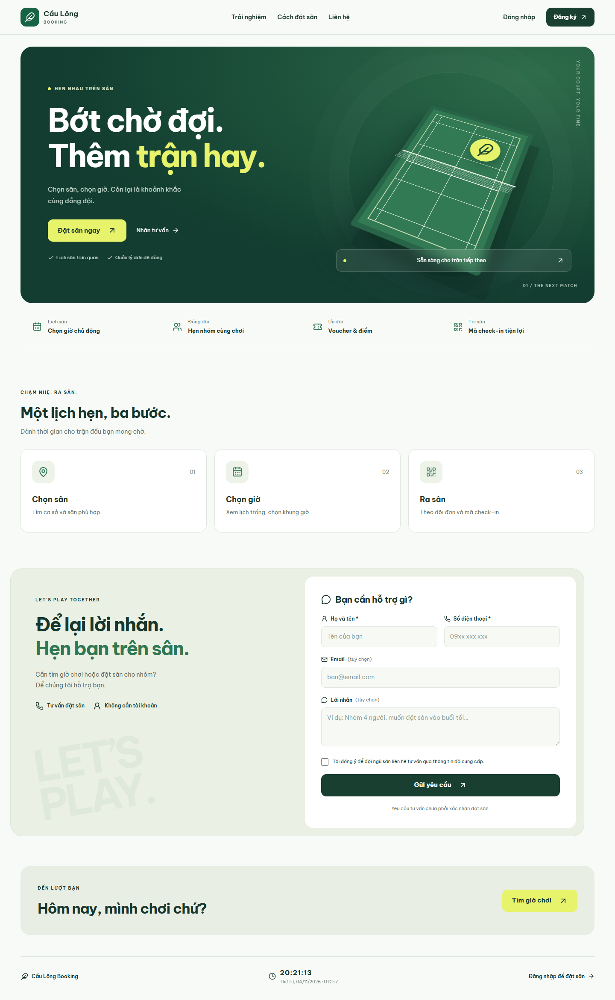
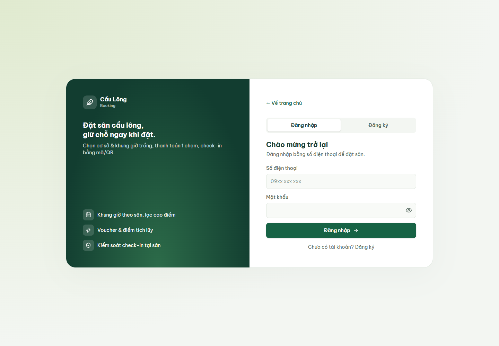
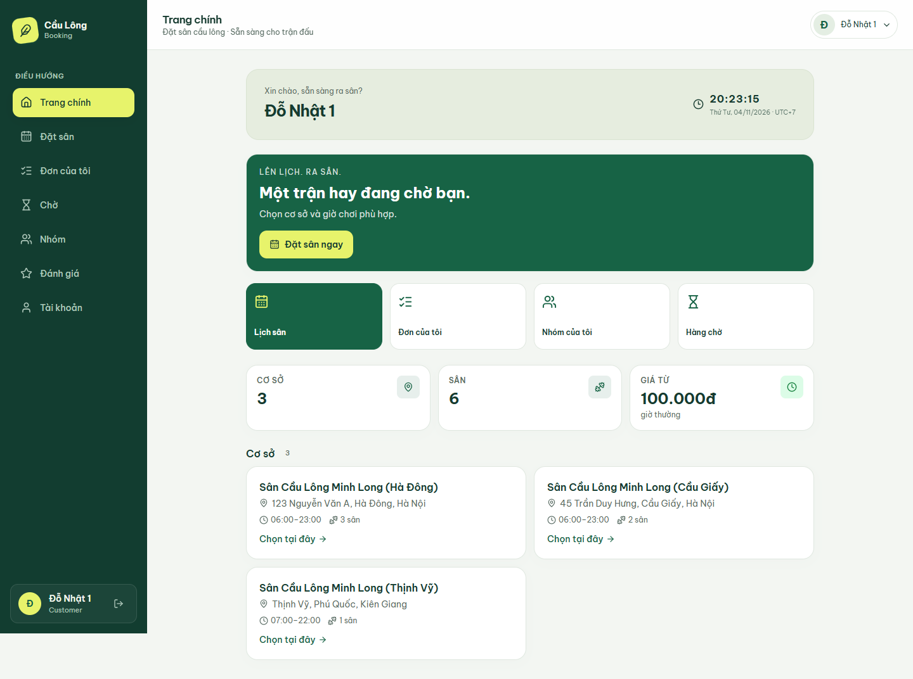
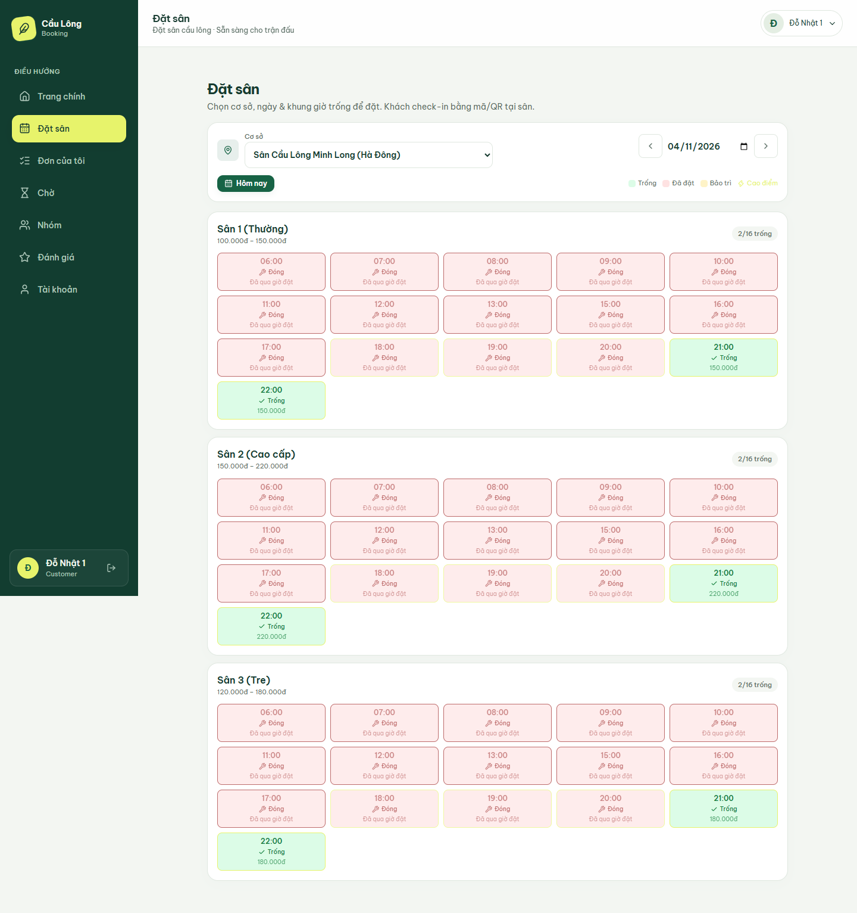
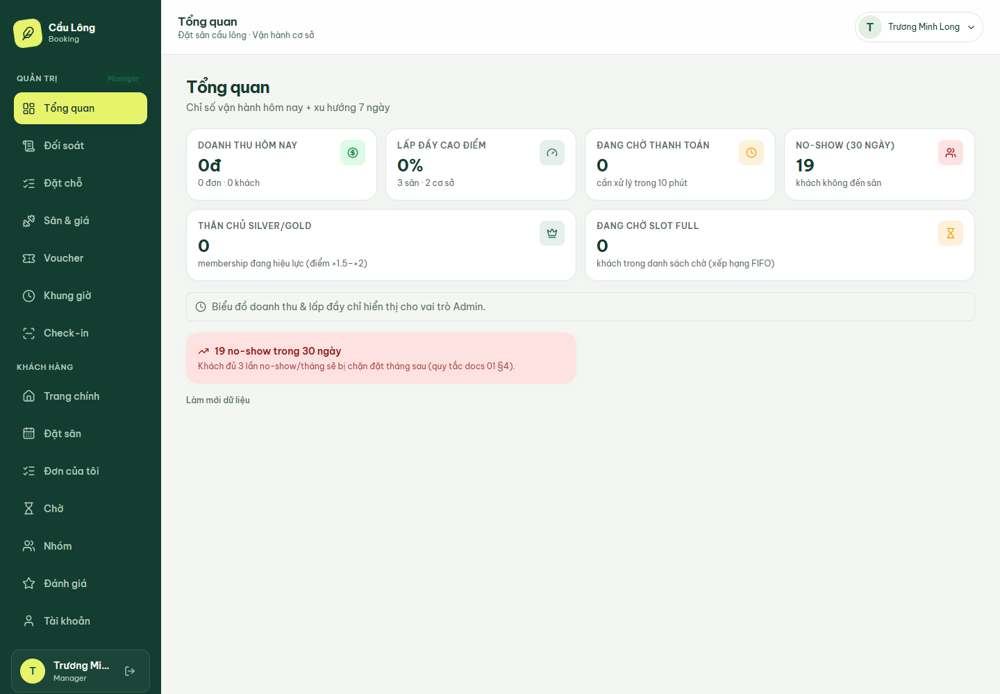
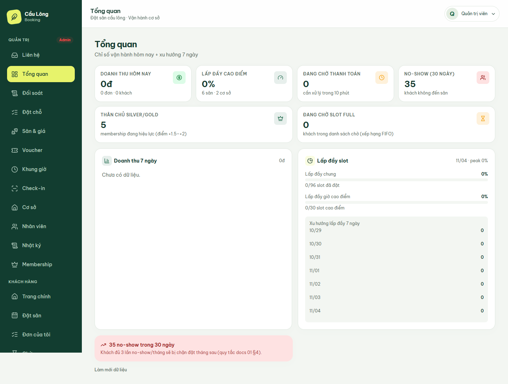
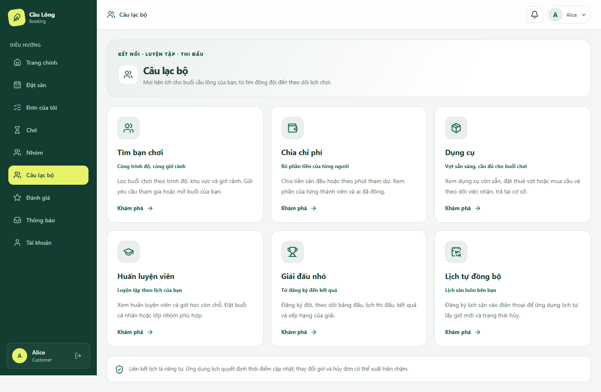
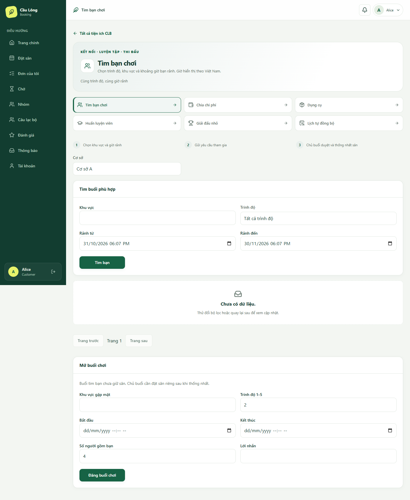
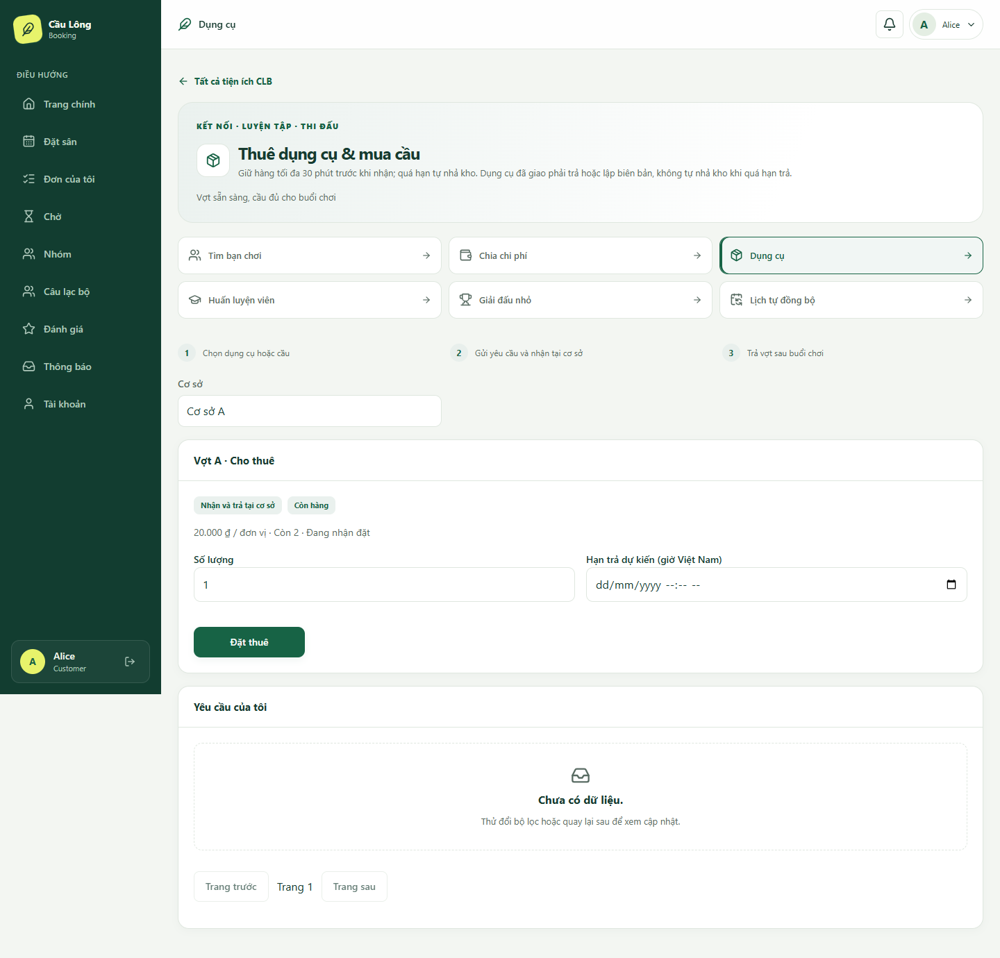
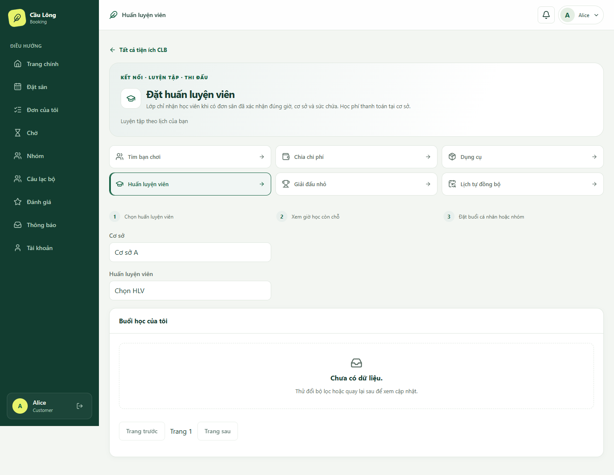

# 🏸 BadmintonBooking

Ứng dụng đặt sân cầu lông và quản lý câu lạc bộ dành cho người chơi, nhân viên và quản trị viên. Dự án full-stack sử dụng **React · TypeScript · ASP.NET Core · SQL Server / PostgreSQL**, tập trung vào lịch sân nhất quán, phân quyền theo chi nhánh và quy trình đặt chỗ có lịch sử thay đổi.

**[Mở bản demo](https://badminton-bvqs.onrender.com/)** · [Ảnh từng chức năng](docs/FEATURE-TOUR.md) · [Kiến trúc backend](Backend/ARCHITECTURE.md) · [API & cấu hình](docs/13-configuration.md) · [Tài liệu dự án](docs/00-README.md)



## Thử ngay — dành cho người xem dự án

Mở **[BadmintonBooking trên Render](https://badminton-bvqs.onrender.com/)** → **[Đăng nhập](https://badminton-bvqs.onrender.com/auth)**. Chủ dự án đồng ý công khai các tài khoản mẫu dưới đây để trải nghiệm.

| Vai trò | Số điện thoại | Mật khẩu | Trải nghiệm |
| --- | --- | --- | --- |
| **Người chơi — Customer** | `0910000000` | `Pass@123` | Lịch sân, báo giá, đơn của tôi, nhóm và CLB |
| **Quản lý — Manager** | `0900000002` | `Admin@123` | Đơn, thanh toán tại quầy, check-in và vận hành theo chi nhánh |
| **Quản trị — Admin** | `0900000001` | `Admin@123` | Tổng quan, cơ sở/sân, nhân viên, cấu hình và báo cáo |

**Đã kiểm tra ngày 04/11/2026:** cả ba tài khoản đăng nhập thành công trên Render, đúng vai trò.

Đây là các tài khoản mẫu của dự án; tài khoản Admin có quyền quản trị ứng dụng. Dùng các cửa sổ trình duyệt hoặc chế độ ẩn danh riêng để thử nhiều vai trò. Server miễn phí có thể cần một lúc để khởi động ở lần truy cập đầu.

Nhiều người có thể dùng chung tài khoản nên dữ liệu hiển thị có thể thay đổi. Vui lòng giữ nguyên mật khẩu, tài khoản mẫu và dữ liệu người thử khác; dùng thông tin giả khi trải nghiệm. Chưa có bằng chứng cơ chế tự reset định kỳ hoặc khóa thao tác dành riêng cho demo như WebAttendance. [Tài khoản, giới hạn và phạm vi demo](docs/DEMO.md).

### Vai trò trong hệ thống

| Vai trò | Có thể trải nghiệm |
| --- | --- |
| **Customer — Người chơi** | Xem lịch trống, nhận báo giá, đặt sân, dùng voucher/điểm, theo dõi đơn và các tiện ích CLB |
| **Manager — Quản lý cơ sở** | Xử lý đơn, xác nhận thanh toán tại quầy, check-in, quản lý dụng cụ, HLV và giải trong chi nhánh được giao |
| **Admin — Quản trị viên** | Quản lý chi nhánh, sân, khung giờ, nhân viên, phân quyền, báo cáo và nhật ký |

## Kịch bản trải nghiệm 5 phút

1. Đăng nhập **Người chơi** → **Đặt sân**: chọn cơ sở, ngày và khung giờ còn trống; xem báo giá từ server, thử voucher hoặc điểm trước khi xác nhận.
2. Mở **Đơn của tôi** → chi tiết đơn: xem trạng thái, thời hạn giữ chỗ và hướng dẫn thanh toán. Với thanh toán tại quầy, nhân viên đúng chi nhánh xác nhận khoản thu; xem hướng dẫn chưa có nghĩa đã thanh toán.
3. Ở cửa sổ **Manager/Admin**, mở danh sách đơn và **Check-in** để thử xử lý đơn hợp lệ trên dữ liệu thử nghiệm. Trạng thái và thời gian được kiểm tra phía server.
4. Mở **Nhóm** để quản lý đồng đội; vào **Câu lạc bộ → Chia chi phí** để chọn đơn nhóm đủ điều kiện, chia đều hoặc theo phút tham dự và ghi nhận ai đã đóng.
5. Vào **Câu lạc bộ → Tìm bạn chơi**: lọc trình độ, khu vực, giờ rảnh; mở buổi hoặc xin tham gia. Chủ buổi duyệt yêu cầu; buổi tìm bạn chưa tự giữ sân.
6. Khám phá **Dụng cụ**, **Huấn luyện viên** và **Giải đấu nhỏ**. Nhân viên có các trang riêng để quản lý kho/giao trả, lịch học và đăng ký/chia bảng/lịch đấu/kết quả.
7. Mở **Lịch tự đồng bộ**: tạo liên kết lịch riêng tư, đăng ký trong ứng dụng lịch và thử đổi/hủy đơn đủ điều kiện. Ứng dụng lịch tự đọc lại feed theo chu kỳ của nó; liên kết có thể xoay hoặc thu hồi.

Các thao tác cần catalogue, lịch học, giải hoặc đơn hợp lệ. Chức năng có trong source có thể chưa được triển khai đầy đủ trên bản Render; nếu muốn kiểm tra đúng source hiện tại, dùng hướng dẫn local bên dưới. Lịch đồng bộ trên điện thoại và quét QR bằng thiết bị thật cần kiểm chứng riêng; không suy ra từ kịch bản browser.

## Các chức năng hiện có

**CURRENT:** bảng dưới mô tả chức năng trong source. Bằng chứng kiểm thử, lỗi đã phát hiện và giới hạn theo từng thời điểm nằm trong [worklog](docs/worklog.md).

| Nhóm | Hành vi |
| --- | --- |
| Lịch sân & đặt chỗ | Lọc cơ sở/ngày, xem lịch trống, báo giá phía server, giữ chỗ có hạn, chặn trùng sân/slot, idempotency khi thử lại |
| Quản lý đơn | Theo dõi trạng thái, đổi lịch theo điều kiện, đặt nhiều giờ/định kỳ, lịch sử đơn, hủy và xử lý hoàn tiền |
| Thanh toán & ưu đãi | Cash/QR tại quầy, adapter mock/online, voucher mỗi mã một lần/tài khoản, dùng điểm và snapshot giá trên đơn |
| Check-in & hàng chờ | Mã/token QR, kiểm tra chi nhánh và cửa sổ check-in, xử lý hiện diện/no-show, hàng chờ và thông báo |
| Nhóm & đánh giá | Nhóm có mã mời, buổi chơi/RSVP, đánh giá sân, phản hồi và kiểm duyệt |
| Tìm bạn chơi | Lọc trình độ 1–5, khu vực, khoảng rảnh; mở buổi, xin tham gia, duyệt/từ chối/rút |
| Chia chi phí nhóm | Chia đều hoặc theo phút tham dự, xem phần từng người và tổng đã đóng/còn lại; ghi nhận đóng góp nội bộ |
| Thuê dụng cụ & mua cầu | Tồn khả dụng, giữ hàng, hết hạn giữ, giao/nhận/trả, biên bản hư/mất và quản lý kho theo cơ sở |
| Đặt huấn luyện viên | Hồ sơ HLV, lịch còn chỗ, buổi cá nhân/lớp nhóm, gắn sân học đã xác nhận, đặt/hủy/hoàn thành |
| Giải đấu nhỏ | Đăng ký đội, chia bảng vòng tròn, lịch trận, kết quả/xếp hạng và lịch sử sửa điểm có lý do/phiên bản |
| Lịch tự đồng bộ | Feed lịch đăng ký riêng tư, giữ UID khi đổi giờ, phản ánh đơn hủy, xoay/thu hồi liên kết và trạng thái đọc feed |
| Vận hành & quản trị | Chi nhánh, sân/giá/khung giờ, bảo trì, nhân viên, báo cáo, audit, liên hệ, phản ánh và bàn giao ca |
| Giao diện & tiện ích | PC/mobile, sáng/tối, thông báo, hồ sơ, ảnh PNG/JPEG và yêu cầu dữ liệu; cache được xóa khi đổi danh tính |

Xem [nghiệp vụ](docs/01-business-analysis.md), [tiện ích đặt sân](docs/17-booking-experience.md), [sáu chức năng CLB](docs/18-club-features.md) và [hoàn thiện CLB](docs/19-club-hardening.md).

## Điểm kỹ thuật

- **Frontend theo module:** React 19, TypeScript, Vite 8, Tailwind CSS 4 và React Router 7; TanStack Query quản lý dữ liệu server, Zustand giữ trạng thái phiên. Trang tổng quan `/club` dẫn tới sáu tiện ích, có lối vào quản lý cho nhân viên.
- **Backend phân tầng:** ASP.NET Core 8 và EF Core; API ghép cấu hình, xác thực, adapter và jobs. Services dùng `ICurrentUser` cùng hợp đồng repository; Core/contracts không phụ thuộc EF hoặc ASP.NET HTTP.
- **Nhất quán dữ liệu:** transaction, khóa nghiệp vụ, unique constraint và request fingerprint cho đặt sân; snapshot giữ giá lịch sử. Repository chịu trách nhiệm provider và ánh xạ lỗi persistence.
- **Phân quyền:** đăng nhập SĐT + BCrypt + JWT; server kiểm trạng thái tài khoản, quyền, owner và chi nhánh. Không dựa vào việc ẩn nút trên giao diện để bảo vệ dữ liệu.
- **Hai provider database:** SQL Server và PostgreSQL có bộ migrations riêng. Production không tự migrate hoặc seed demo; thay đổi schema được phát hành bằng quy trình riêng.
- **Lịch và thời gian:** nghiệp vụ theo giờ Việt Nam, timestamp UTC; liên kết calendar dùng token riêng tư, database chỉ lưu hash. Feed đăng ký là luồng chỉ đọc, không phải OAuth đồng bộ hai chiều.
- **Kiểm thử:** .NET unit/service/configuration/architecture, SQL/HTTP integration, frontend unit và Playwright. Tách browser API mock với browser gọi API/database thật; không coi build xanh là nghiệm thu production.

## Ảnh giao diện

| Trang giới thiệu — LIVE | Đăng nhập — LIVE |
| --- | --- |
|  |  |

| Người chơi — LIVE | Lịch đặt sân — LIVE |
| --- | --- |
|  |  |

| Quản lý — LIVE | Quản trị — LIVE |
| --- | --- |
|  |  |

| Tổng quan CLB — LOCAL / API MOCK | Tìm bạn chơi — LOCAL / API MOCK |
| --- | --- |
|  |  |

| Dụng cụ — LOCAL / API MOCK | Huấn luyện viên — LOCAL / API MOCK |
| --- | --- |
|  |  |

**[Thư viện đầy đủ: đặt sân, sáu tiện ích CLB và mobile](docs/FEATURE-TOUR.md).** Ảnh LIVE chụp từ Render ngày 04/11/2026; ảnh CLB từ giao diện chạy local với API mock/dữ liệu giả, không phải bằng chứng triển khai live. Nguồn ảnh được ghi ở đầu thư viện.

## Chưa nghiệm thu / hướng phát triển

| Nhãn | Hạng mục và giới hạn |
| --- | --- |
| **CURRENT** | Source có các luồng đặt sân, vận hành và sáu tiện ích CLB; kết quả local được ghi theo lệnh và thời điểm trong worklog |
| **TARGET** | Hoàn tất các gate phát hành: merchant sandbox, thiết bị thật, endurance, backup/restore và giám sát vận hành |
| **NOT VERIFIED** | Nghiệm thu gateway/tiền thật và hoàn tiền online; `Payment:OnlineRefunds:Enabled` mặc định `false` |
| **NOT VERIFIED** | Mức đồng bộ trên Apple/Google Calendar thật, thời gian client cập nhật và cấu hình ingress/APM che token |
| **NOT VERIFIED** | Camera/USB trên mọi thiết bị; source có luồng QR nhưng quyền camera, HTTPS và phần cứng ảnh hưởng trải nghiệm |
| **TARGET** | OTP/refresh và các tích hợp ngoài còn mở theo kế hoạch; danh tính hiện tại vẫn là JWT/BCrypt của ứng dụng |

Chia chi phí nhóm là ghi nhận đóng góp nội bộ; phí dụng cụ/HLV được xử lý tại cơ sở, không tự trở thành giao dịch gateway. Lịch đăng ký có thể cập nhật chậm theo ứng dụng; thu hồi liên kết không xóa sự kiện đã cache trên điện thoại.

[Rà soát luồng ngày 29/10/2026](docs/20-flow-review-20261029.md) ghi nhận lỗi sân lớp bị hủy và thiếu guard chi nhánh ngừng hoạt động trong một số luồng. Không dùng các lần test xanh khác để coi các lỗi này đã đóng; trạng thái sửa cần bằng chứng mới trong worklog.

## Chạy local

Yêu cầu Git, PowerShell, **SDK .NET từ 9.0.300 theo [global.json](global.json)** (cho phép roll forward tới major stable mới hơn), runtime **.NET/ASP.NET Core 8**, **Node.js 24** và **SQL Server local**. Ứng dụng vẫn target `net8.0`; PostgreSQL có hướng dẫn cấu hình riêng trong [chuẩn cấu hình](docs/13-configuration.md).

**1. Lấy source và chuẩn bị backend** — từ thư mục chứa dự án:

```powershell
git clone https://github.com/taiDinh303/Badminton.git
cd Badminton
dotnet tool restore
dotnet restore Backend/Badminton.slnx
```

**2. Cấu hình local** — lưu `ConnectionStrings:BadmintonBooking` và `JwtSettings:Key` trong User Secrets của `Backend/API/Badminton.API.csproj` hoặc biến môi trường. Khóa JWT riêng cần ít nhất 32 byte UTF-8. Backend không tự đọc `.env`; không đưa secret vào `VITE_*`.

Từ thư mục gốc, kiểm tra cấu hình trước khi chạy:

```powershell
dotnet run --project Backend/API/Badminton.API.csproj --launch-profile http -- --check-config
```

`--check-config` không kết nối database, migrate, seed, khởi động worker hoặc gọi dịch vụ ngoài. Kiểm tra đúng database local trước bước chạy API: Development có thể migrate/seed theo cờ `DatabaseInitialization`.

**3. Chạy backend** — terminal thứ nhất, tại thư mục gốc:

```powershell
dotnet run --project Backend/API/Badminton.API.csproj --launch-profile http
```

**4. Chạy frontend** — terminal thứ hai, tại thư mục `Frontend/`:

```powershell
npm ci
npm run dev
```

Frontend tại **http://localhost:5173**, API tại **http://localhost:5131**, Swagger Development tại **http://localhost:5131/swagger**. Dev server proxy `/api` tới API local; `VITE_API_URL` mặc định `/api/v1`. `API_PROXY_TARGET` đổi đích proxy khi cần.

Hướng dẫn chi tiết và xử lý cổng bận: [Local setup](docs/10-setup-local.md). Production không tự migrate/seed; không chạy test hoặc load helper vào database ứng dụng/live.

## Kiểm tra chất lượng

Frontend — tại `Frontend/`:

```powershell
npm test
npm run lint
npm run build
npx --no-install playwright install chromium
npm run test:e2e
```

Backend — tại thư mục gốc, chỉ dùng SQL Server loopback dành cho test:

```powershell
$env:BADMINTON_TEST_SQLSERVER = '(localdb)\MSSQLLocalDB'
dotnet test Backend/Tests/Badminton.Tests.csproj -c Release
```

Fixture tạo database `BadmintonTest_*` riêng; điều chỉnh instance theo máy. Cách chạy PostgreSQL và browser API/DB thật nằm trong [chiến lược kiểm thử](docs/05-testing-strategy.md).

Bằng chứng đã ghi nhận: ngày **29/10/2026**, backend SQL **434/434**, browser mock **106/106**, browser API/DB thật **3/3**; ngày **31/10/2026**, frontend unit **16/16** và browser CLB mock **17/17**. Đây là lịch sử kiểm tra với phạm vi riêng, không phải kết quả CI trực tiếp hoặc lần chạy mới khi sửa README. [Worklog](docs/worklog.md) lưu lệnh, lỗi phát hiện và giới hạn.

## Cấu trúc repository

| Thư mục | Nội dung |
| --- | --- |
| `Backend/API` | REST `/api/v1`, xác thực, cấu hình, adapters và background jobs |
| `Backend/Services` | Nghiệp vụ đặt sân, thanh toán, điểm, vận hành và CLB |
| `Backend/Contract.Services` | Hợp đồng dịch vụ |
| `Backend/Contract.Repositories` | Hợp đồng repository và entity |
| `Backend/Repositories` | EF Core, đăng ký provider, transaction và migrations |
| `Backend/Core`, `Backend/ModelViews` | Thành phần nền tảng và request/response DTO |
| `Backend/Tests`, `Backend/BrowserTests` | Unit/integration tests và host browser test biệt lập |
| `Frontend` | React/TypeScript, module tính năng, API transport, theme, unit và Playwright |
| `docs` | Nghiệp vụ, kiến trúc, cấu hình, kế hoạch và bằng chứng |
| `scripts`, `tools` | Công cụ phát triển, kiểm tra và diễn tập vận hành trên database test |

## Tài liệu liên quan

- [Nghiệp vụ và phân quyền](docs/01-business-analysis.md) · [Database](docs/02-database-design.md) · [Workflow](docs/03-workflow.md).
- [Thiết kế giao diện](docs/07-ui-design-system.md) · [Kiến trúc backend](Backend/ARCHITECTURE.md) · [Frontend](Frontend/README.md).
- [Kế hoạch và việc còn mở](docs/08-plan.md) · [Chuẩn cấu hình](docs/13-configuration.md) · [Release checklist](docs/14-release-checklist.md).
- [Mục lục đầy đủ](docs/00-README.md) · [Worklog](docs/worklog.md).

Thực hiện bởi  **[Phùng Vĩnh Luân](https://github.com/thankiemsama)**.
