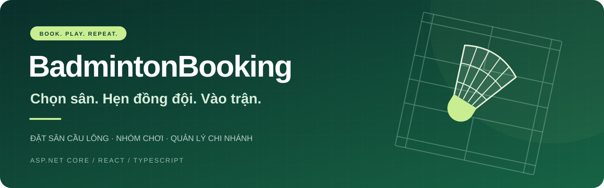

<p align="center">
  
</p>

# 🏸 BadmintonBooking

<p align="center">
  <strong>Từ một lịch hẹn trên sân đến cả quy trình vận hành.</strong><br />
  Ứng dụng đặt sân cầu lông với lịch trống, đặt chỗ, nhóm chơi và quản lý nhiều chi nhánh.
</p>

<p align="center">
  
  
  
  
</p>

**[Khám phá tính năng](#có-gì-trong-dự-án)** · **[Chạy local](#chạy-trên-máy-của-bạn)** · **[Kiến trúc](Backend/ARCHITECTURE.md)** · **[Tài liệu](docs/00-README.md)**

## Có gì trong dự án?

Một buổi cầu lông bắt đầu từ việc tìm được sân phù hợp. BadmintonBooking nối tiếp hành trình đó: xem lịch trống, nhận báo giá, giữ chỗ, theo dõi đơn và check-in; phía quản lý có công cụ vận hành theo chi nhánh.

| 🏸 Người chơi | 🗓️ Quản lý sân | 🛠️ Quản trị hệ thống |
| --- | --- | --- |
| Tìm sân và xem khung giờ trống | Theo dõi đơn đặt theo ngày | Quản lý chi nhánh, sân và khung giờ |
| Xem báo giá, áp voucher và dùng điểm | Xác nhận thanh toán tại quầy | Quản lý tài khoản và phân quyền |
| Theo dõi đơn và thời hạn giữ chỗ | Check-in bằng mã/token QR | Cấu hình giá, sức chứa và bảo trì |
| Vào hàng chờ khi chưa có chỗ | Xử lý hiện diện và no-show | Xem báo cáo doanh thu, công suất |
| Tạo nhóm, mời đồng đội, đánh giá sân | Thao tác trong chi nhánh được giao | Theo dõi audit và yêu cầu liên hệ |

*CURRENT: các luồng trên đã có trong source. Phạm vi kiểm chứng được ghi riêng ở [worklog](docs/worklog.md).*

## Một lịch sân, cả hành trình

**Chọn sân → Chọn ngày & giờ → Xem báo giá → Giữ chỗ → Thanh toán → Check-in → Hoàn thành**

- **Giữ lịch nhất quán:** chặn trùng sân/slot, có thời hạn giữ chỗ và kiểm tra yêu cầu đặt lại bằng idempotency key.
- **Giá rõ trước khi đặt:** báo giá phía server, voucher và điểm; đơn lịch sử giữ snapshot giá.
- **Gắn kết người chơi:** nhóm có mã mời, hàng chờ, đánh giá và điểm thành viên.
- **Vận hành theo quyền:** Customer, Manager và Admin; server kiểm tra quyền và chi nhánh.
- **Theo dõi vòng đời đơn:** hủy, hoàn tiền, điểm và lịch sử giao dịch có luồng xử lý riêng.

> Thanh toán tại quầy và mock phục vụ luồng local. Adapter online đã có trong source; nghiệm thu gateway thật vẫn **NOT VERIFIED**, hoàn tiền online mặc định tắt.

## Bên trong được xây thế nào?

| Thành phần | Công nghệ & cách tổ chức |
| --- | --- |
| Frontend | React 19 · TypeScript · Vite 8 · Tailwind CSS 4 |
| Dữ liệu phía client | TanStack Query · Zustand · React Router 7 |
| Backend | ASP.NET Core 8 · EF Core · REST API `/api/v1` |
| Database | SQL Server và PostgreSQL, bộ migration riêng cho từng provider |
| Xác thực | JWT · BCrypt · kiểm tra quyền và trạng thái tài khoản phía server |
| Kiểm thử | .NET tests · Playwright · SQL/HTTP integration · browser regression |

```text
BadmintonBooking/
├── Frontend/                React, các module tính năng và giao diện
├── Backend/
│   ├── API/                 HTTP, xác thực, cấu hình và background jobs
│   ├── Services/            Nghiệp vụ đặt sân, thanh toán và điểm
│   ├── Contract.Services/   Hợp đồng dịch vụ
│   ├── Contract.Repositories/  Hợp đồng dữ liệu
│   ├── Repositories/        EF Core, transaction và migrations
│   ├── Core/                Thành phần nền tảng dùng chung
│   ├── ModelViews/          Request/response DTO
│   └── Tests/               Configuration, architecture, SQL và HTTP
├── docs/                    Đặc tả, hướng dẫn và bằng chứng kiểm thử
└── tools/                   Công cụ diễn tập vận hành trên DB test
```

Contracts độc lập với EF/HTTP; Services dùng hợp đồng repository và `ICurrentUser`. Xem [kiến trúc backend](Backend/ARCHITECTURE.md) và [cấu trúc frontend](Frontend/README.md) để đi sâu.

## Chạy trên máy của bạn

**Chuẩn bị:** Git, PowerShell, SDK .NET theo [global.json](global.json), runtime .NET/ASP.NET Core 8, Node.js 24 và SQL Server local. Hướng dẫn đầy đủ ở [thiết lập local](docs/10-setup-local.md).

**1. Build backend** — tại thư mục gốc repo:

```powershell
dotnet tool restore
dotnet restore Backend/Badminton.slnx
.\build.ps1
```

**2. Đặt cấu hình local** — lưu `ConnectionStrings:BadmintonBooking` và `JwtSettings:Key` vào User Secrets của `Backend/API/Badminton.API.csproj` hoặc biến môi trường. Khóa JWT riêng cần ít nhất 32 byte UTF-8. Xem [chuẩn cấu hình](docs/13-configuration.md); backend không tự đọc `.env`.

Kiểm tra cấu hình trước khi chạy:

```powershell
dotnet run --project Backend/API/Badminton.API.csproj --launch-profile http -- --check-config
```

`--check-config` chỉ kiểm cấu hình, không kết nối DB, migrate, seed hoặc chạy worker.

**3. Mở hai terminal** — sau khi đã cấu hình DB local:

```powershell
# Terminal 1 — thư mục gốc repo
dotnet run --project Backend/API/Badminton.API.csproj --launch-profile http
```

```powershell
# Terminal 2 — thư mục gốc repo
cd Frontend
npm ci
npm run dev
```

Mở **[ứng dụng local](http://localhost:5173)** · **[Swagger Development](http://localhost:5131/swagger)**.

> Development có thể migrate/seed DB local theo cờ cấu hình. Kiểm tra đúng DB trước khi khởi động. Production không tự migrate hoặc seed dữ liệu demo.

## Trạng thái & bằng chứng

| Nhãn | Phạm vi |
| --- | --- |
| **CURRENT** | Source đặt sân và vận hành; bằng chứng local ngày 25/10/2026 gồm backend 237/237 trên mỗi provider, sau đó focused 16/16 trên mỗi provider; Chromium 64/64, Firefox/WebKit 30/30. |
| **TARGET** | Hoàn tất các gate phát hành: gateway sandbox, thiết bị quét thật, tải dài và vận hành production. |
| **NOT VERIFIED** | Merchant/gateway thật, cloud/live migration, remote CI/Linux/Docker và nghiệm thu production trong bằng chứng trên. |

Các con số là kết quả đã ghi nhận, không phải badge CI trực tiếp. Xem [lệnh, thời điểm và giới hạn kiểm thử](docs/worklog.md), [kế hoạch](docs/08-plan.md) và [release checklist](docs/14-release-checklist.md).

## Tìm đúng tài liệu

| Bạn muốn… | Bắt đầu ở đây |
| --- | --- |
| Hiểu nghiệp vụ, quyền và chính sách đặt sân | [Phân tích nghiệp vụ](docs/01-business-analysis.md) |
| Đọc schema và luồng xử lý | [Database](docs/02-database-design.md) · [Workflow](docs/03-workflow.md) |
| Chạy dự án, xử lý lỗi cấu hình | [Local setup](docs/10-setup-local.md) · [Configuration](docs/13-configuration.md) |
| Hiểu giao diện và cấu trúc code | [UI design system](docs/07-ui-design-system.md) · [Frontend](Frontend/README.md) |
| Kiểm tra chất lượng và phần còn mở | [Testing](docs/05-testing-strategy.md) · [Worklog](docs/worklog.md) |
| Tìm toàn bộ tài liệu | [Chỉ dẫn tài liệu](docs/00-README.md) |

---

**Thực hiện bởi Đinh Văn Tài & Phùng Vĩnh Luân.**

Thấy dự án hữu ích? Bạn có thể **⭐ Star** để theo dõi, hoặc mở **Issue** kèm bước tái hiện để góp ý và báo lỗi.
