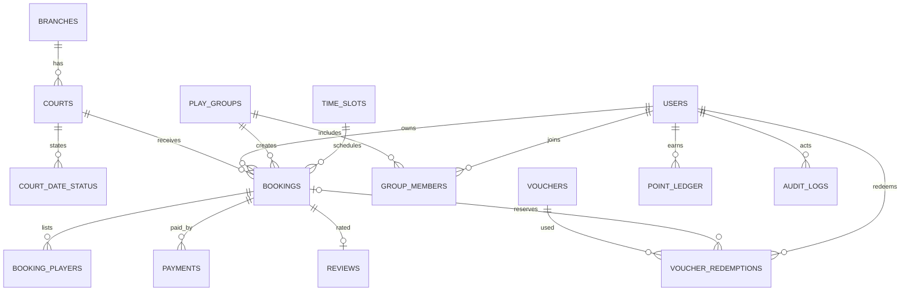

# 02 — Thiết kế dữ liệu hệ thống đặt sân cầu lông

> **Chủ tài liệu: Đinh Văn Tài.** Cập nhật: 16/10/2026.
> **EN/AI:** This doc describes the **source EF Core model** (`Repositories/Context/DbContext.cs`, 15 tables).
> **Dev baseline = SQL Server, `int` PKs, enums as `nvarchar`.** Production target = Supabase Postgres (target only; provider, migration and raw SQL must be reviewed).

## 1. Nguyên tắc dữ liệu

- Postgres (prod) / SQL Server (dev) lưu: hồ sơ, cơ sở, sân, đặt chỗ, thanh toán, voucher, điểm, audit, review.
- **Ảnh chỉ nằm trong Storage** (prod: Supabase buckets), **không lưu blob/base64 trong DB**. Dev dùng cột `ImageUrl` (string path).
- Booking cập nhật trạng thái khi hủy, giữ bản ghi và tiền snapshot; hoàn tiền tạo Payment riêng. Ledger/audit có thiết kế append-only ở ứng dụng, chưa là bảo vệ bất biến DB trước mọi thao tác đặc quyền.
- Mọi timestamp lưu UTC; xác định ngày đặt & deadline hiển thị theo `Asia/Ho_Chi_Minh` (Hanoi clock, fixed UTC+7).
- Chỉ dùng schema cần cho V1; mọi thay đổi schema qua **migration có phiên bản** (EF Core), không sửa tay schema production.
- **Nguồn chân thực = DB.** Chống overbooking bằng unique filtered index, không chỉ app-level lock.

## 2. Sơ đồ quan hệ



> Bảng entity (C#) nằm ở `Contract.Repositories/Entity/*.cs`; mapping + index ở `Repositories/Context/DbContext.cs`. Các bảng dưới dùng **tên bảng DB** (singular/plural theo mapping).

## 3. Bảng và trường cốt lõi (kết hợp thực tế)

| Bảng (DB) | Entity (C#) | Trường quan trọng | Ràng buộc / mục đích |
| --- | --- | --- | --- |
| `Branches` | `Branch` | `Name`,`Address`,`OpenTime`,`CloseTime`,`Status` | Unique `Name`; `Status` = `Active/Closed`. Manager có thể gắn `BranchId` (1 manager = 1 cơ sở). |
| `Courts` | `Court` | `BranchId`,`Code`,`Name`,`Surface`,`PriceLowPeak`,`PricePeak`,`WeekendSurcharge`,`Capacity`,`Amenities`,`ImageUrl`,`RatingAvg`,`RatingCount`,`IsActive` | Unique `(BranchId,Code)`; `Surface` = `Sindalo/Carpet/Wood`; giá là **int** VND/giờ; `Amenities` = JSON array string. |
| `TimeSlots` | `TimeSlot` | `Label`,`StartTime`,`EndTime`,`IsPeak`,`IsActive` | Unique `(StartTime,EndTime)`. Seed = 17 slot 06:00–22:00; `IsPeak` = bắt đầu ≥18:00. Có API quản trị; V1 yêu cầu slot 60 phút. |
| `CourtDateStatus` | `CourtDateStatusEntry` | `CourtId`,`Date`,`Status`,`Note` | PK `(CourtId,Date)`; `Status` = `Open/Maintenance/Closed`, default `Open`. Khác `Open` → không cho đặt. |
| `PlayGroups` | `PlayGroup` | `Name`,`OwnerId`,`MaxMembers` | `OwnerId` = customer tạo nhóm; `MaxMembers` tối đa 10. |
| `GroupMembers` | `GroupMember` | `GroupId`,`UserId` | PK `(GroupId,UserId)`; khách thuộc nhiều nhóm; nhóm không trùng khách. |
| `Bookings` | `Booking` | `BookingCode`,`IdempotencyKey`,`UserId`,`GroupId`,`CourtId`,`SlotId`,`BranchId`,`Date`,`PlayerCount`,`Status`,`TotalAmount`,`DiscountAmount`,`PayableAmount`,`PointsEarned`,`PointsRedeemed`,`PendingExpiresAt`,`CancelReason`,`CancelledAt`,`VoucherRedemptionId` | Unique `BookingCode`; filtered unique `IdempotencyKey` (chống double-create); **filtered unique `ux_court_slot_active`** chống overbooking; `Status` = `Pending/Confirmed/Completed/Cancelled/NoShow/Refunded`. |
| `BookingPlayers` | `BookingPlayer` | `BookingId`,`UserId` | PK `(BookingId,UserId)`; có IsCreator; quyền hủy phải kiểm tra service, không suy ra từ cột. |
| `Payments` | `Payment` | `BookingId`,`UserId`,`Amount`,`Method`,`GatewayRef`,`Status`,`RefundAmount`,`RefundedAt`,`RawResponse`,`PaidAt` | `Method` = `VnPay/MoMo/Zalopay/Cash/QR`; `Status` = `Pending/Success/Failed/Refunded/PartialRefund`; filtered unique `GatewayRef` (idempotent webhook). **Hoàn tiền = record mới, không sửa record gốc.** |
| `Vouchers` | `Voucher` | `Code`,`Type`,`Value`,`MaxValue`,`MinSpend`,`MaxPerUser`,`TotalQty`,`UsedQty`,`ValidFrom`,`ValidUntil`,`IsActive` | Unique `Code`; `Type` = `Percent/Fixed`. `Percent` có trần (`MaxValue`); `Fixed` là VND. |
| `VoucherRedemptions` | `VoucherRedemption` | `Id`,`VoucherId`,`UserId`,`BookingId?`,`DiscountAmount`,`RedeemedAt` | **Unique `(VoucherId,UserId)`** — 1 khách dùng 1 voucher 1 lần. |
| `PointLedger` | `PointLedger` | `UserId`,`Delta`,`Reason`,`BookingId`,`LedgerKey`,`CreatedAt` | Append-only; `Delta` +/−; filtered unique `LedgerKey` (idempotent redeem/restore); số dư = tổng delta theo user. |
| `Reviews` | `Review` | `BookingId`,`CourtId`,`UserId`,`Rating`,`Comment`,`Images`,`CreatedAt` | **Unique `BookingId`** (1 đánh giá/đặt chỗ); `Rating` 1–5; chỉ tạo khi `Completed`. |
| `Users` | `User` | `FullName`,`PhoneNumber`,`Email`,`PasswordHash`,`Role`,`BranchId`,`Status`,`IsVerified`,`NoShowCount`,`NoShowPeriod`,`NoShowLimited`,`NoShowLimitedPeriod` | Unique `PhoneNumber`; **filtered unique `ux_active_admin`** (`Status='Active' AND Role='Admin'`). Cờ no-show: 3 lần/tháng → chặn đặt tháng kế. |
| `AuditLogs` | `AuditLog` | `ActorId`,`Action`,`EntityType`,`EntityId`,`BeforeJson`,`AfterJson`,`Reason`,`CreatedAt` | Append-only; snapshot before/after; index `(EntityType,EntityId,CreatedAt)`. Chỉ admin xem toàn bộ. |

> **Dev note:** `Users.PasswordHash` hiện là danh tính ứng dụng; chuyển OTP là TARGET cần mapping identity và migration, chưa xóa cột hoặc hash. Cột no-show (`NoShowCount/NoShowPeriod/NoShowLimited/NoShowLimitedPeriod`) + `Bookings.PointsRedeemed` thêm bằng migration `20261014063758_AddNoShowTrackingAndPointsRedeemed`.

## 4. Chống overbooking (critical)

```csharp
// Repositories/Context/DbContext.cs — Bookings:
e.HasIndex(x => new { x.CourtId, x.Date, x.SlotId })
   .IsUnique()
   .HasFilter("[Status] IN (N'Pending', N'Confirmed')")
   .HasDatabaseName("ux_court_slot_active");
```
- Một `(court_id, date, slot_id)` chỉ có **một** booking `Pending`/`Confirmed`. Khi booking `cancel` → index hết enforce → slot mở lại.
- Service `BookingService.CreateAsync` chạy transaction, INSERT; nếu vi phạm unique (race giữa 2 request song song) → trả **409 `SLOT_CONFLICT`** (kèm hướng dẫn chọn slot khác), không ghi đè.
- Đọc xung đột trong code qua `SqlException.Number == 2601` (không parse message).

**Cửa sổ đặt (BR2):** service kiểm tra `slot.start_time ≥ now()+30min` (Hanoi clock) và `date ≤ today()+30d`.

## 5. Ràng buộc toàn vẹn và yêu cầu nhất quán

- **Tối đa 1 admin active** do index `ux_active_admin`; yêu cầu đúng 1 cần bootstrap và service; giao dịch khóa/xóa tài khoản từ chối nếu sẽ mất admin cuối.
- TARGET chỉ user Active/IsVerified được tạo đặt chỗ, khóa user giữ lịch sử. CURRENT CreateAsync kiểm no-show nhưng chưa guard Active/IsVerified đầy đủ; cần kiểm token sau khóa.
- `Pending` không trả tự hủy sau 10 phút bởi job (không phụ thuộc request cycle); job giải phóng voucher slot + trả điểm redeem (xem `03`/`04`).
- **Webhook là source of truth** cho `Confirmed`; khách đóng tab giữa chừng vẫn xác nhận nếu gateway đã trả. Webhook **idempotent** theo `GatewayRef` (filtered unique index).
- **Hoàn tiền** không sửa payment gốc; tạo record mới `status=Refunded/PartialRefund`.
- **Voucher** 1 khách 1 lần (unique redemption); job expire vô hiệu khi qua `ValidUntil`.
- **Điểm** append-only; hoàn tiền đơn có cộng điểm → giao dịch âm cùng `booking_id` (truy vết).
- Khi `CourtDateStatus` ≠ `Open`: **lock slot mới, KHÔNG tự hủy** booking `Confirmed` đã có; manager quyết định hủy/hoàn qua API (audit + refund).

## 6. Quyền dữ liệu (RLS) & ảnh

> **Prod target:** bật RLS cho mọi bảng nghiệp vụ, policy theo `auth.uid()` + role lưu phía DB, không tin role từ client. Khách chỉ đọc đặt chỗ/voucher/điểm/review của mình; manager đọc/xử lý phạm vi cơ sở gắn; admin theo quyền quản trị đã định nghĩa ở nghiệp vụ. Chặn `UPDATE/DELETE` trực tiếp trên `Bookings/Payments/PointLedger/AuditLogs` từ client; mọi mutation qua API .NET.
> **Dev note:** baseline hiện dùng .NET JWT + service-layer scope check (`AuthorizeStaffScope`), **chưa bật RLS Postgres** — là hạng mục P0 khi cutover Supabase.

Storage bucket (prod):

| Bucket | Access | Nội dung |
| --- | --- | --- |
| `court-images` | public-read | Ảnh sân (CDN) |
| `user-uploads` | RLS (owner) | Avatar, ảnh review |
| `receipts` | service-role only | Hóa đơn, proof thanh toán |

## 7. Indexing strategy (đã code trong `DbContext.cs`)

| Index (DB name) | Loại | Mục đích |
| --- | --- | --- |
| `ux_court_slot_active` | Filtered Unique | Chống overbooking (critical) |
| `ux_active_admin` | Filtered Unique | Chỉ 1 admin active |
| `Bookings.BookingCode` | Unique | Mã đặt chỗ |
| `Bookings.IdempotencyKey` | Filtered Unique | Chống double-create |
| `Bookings.(UserId)` / `(Date)` / `(BranchId,Date)` / `(Status)` | B-tree | Lịch sử khách, dashboard, manager theo cơ sở |
| `Payments.(BookingId)` / `(GatewayRef)` filtered unique / `(Status,PaidAt)` | B-tree | Đối soát, idempotent webhook, conciliation |
| `VoucherRedemptions.(VoucherId,UserId)` | Unique | Chặn dùng voucher lại |
| `PointLedger.(UserId,CreatedAt)` / `LedgerKey` filtered unique | B-tree | Số dư, idempotent redeem |
| `AuditLogs.(EntityType,EntityId,CreatedAt)` | B-tree | Query audit |
| `Reviews.BookingId` unique / `CourtId` | Unique/B-tree | 1 review/đặt chỗ, trung bình sân |

## 8. Kiểu dữ liệu và vòng đời

| Dữ liệu | CURRENT | Lưu ý khi thay đổi |
| --- | --- | --- |
| Khóa | int identity; CourtDateStatus/BookingPlayers/GroupMembers dùng composite key | Không tự đổi UUID khi chuyển Postgres |
| Tiền | int VND, surcharge decimal | Không dùng float; kiểm tra overflow khi tổng báo cáo và quy đổi điểm |
| Date/Time | DateOnly/TimeOnly cho lịch; DateTime UTC cho timestamp | Không ép ngày sân qua UTC làm đổi ngày |
| Enum | String mapping trong SQL Server | Giữ tên trạng thái/case khi migration/raw SQL |
| JSON/ảnh | Amenities/Images/BeforeJson/AfterJson là string có giới hạn | Validate/giới hạn kích thước; URL chưa là upload API |
| Xóa | Có DeletedAt và OnDelete theo mapping | Soft delete không làm biến mất unique index nếu filter không xét DeletedAt |

## 9. Migration, backup và retention

Nguồn model là [DbContext](../Backend/Repositories/Context/DbContext.cs); lịch sử runtime ở [Migrations](../Backend/Repositories/Migrations). SQL root là tham khảo; TestHost dùng EnsureCreated nên không chứng minh migration nâng cấp chạy được.

Quy trình TARGET: kiểm tra drift → sinh/rà migration → thử DB sạch và nâng DB cũ → so số dòng/FK/index/tổng tiền/ledger → backup/restore → release tương thích ngược. Không chạy EnsureDeleted trên DB ứng dụng. Cutover PostgreSQL phải rà raw SQL, filtered index, generated key, transaction, provider error và chính sách quyền.

Các mốc cũ 90 ngày raw response/ảnh, 12 tháng audit là **đề xuất chưa có job và chưa xác nhận căn cứ pháp lý**. Không gọi là compliance bắt buộc. Chốt retention/backup/quyền xóa theo DEC-05 trước triển khai. Booking/payment/ledger cần bảo toàn khả năng đối soát, không xóa cứng qua CRUD thông thường.

## 10. Toàn vẹn cần bổ sung nghiệm thu

| Rủi ro | CURRENT | TARGET/test |
| --- | --- | --- |
| Admin | Unique filter chỉ tối đa một | Không mất admin cuối, bootstrap một |
| Idempotency | Unique key toàn hệ thống | Binding actor/payload, không trả booking khác người |
| Điểm đồng thời | LedgerKey chống trùng theo booking | Hai booking cùng tiêu balance không được âm do race |
| Voucher | Unique một lần/khách; release có xóa redemption | Không coi redemption append-only; release/use đồng thời không vượt UsedQty |
| Slot không chuẩn | Unique chỉ court/date/slotId | Không tự cho slot thời gian chồng lấn khác ID |
| Giá lịch sử | Tổng tiền snapshot; breakdown tính từ sân hiện hành | Snapshot đủ chi tiết, đổi giá không đổi lịch sử |
| Delete cascade | Payments liên kết Booking có cascade | Không xóa booking gốc làm mất payment; kiểm tra quyền vận hành |
| Jobs/refund | Nhiều thao tác cập nhật trạng thái và ledger | Crash/retry/nhiều instance không dở dang hoặc ghi trùng |

Liên quan: [01 nghiệp vụ](01-business-analysis.md), [03 luồng](03-workflow.md), [05 kiểm thử](05-testing-strategy.md), [09 cấu hình](09-deploy-detail.md).
