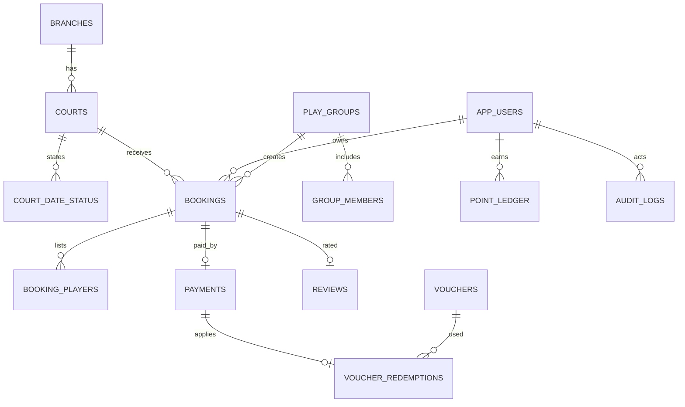

# 02 — Thiết kế dữ liệu hệ thống đặt sân cầu lông

## 1. Nguyên tắc dữ liệu

Supabase Postgres lưu hồ sơ, cơ sở, sân, đặt chỗ, thanh toán, voucher và audit; **ảnh sân, hóa đơn và ảnh đánh giá chỉ nằm trong Supabase Storage** (bucket riêng tư hoặc công khai theo loại), không lưu blob/base64 trong Postgres. Dữ liệu đặt chỗ gốc không bị ghi đè khi hủy; điều chỉnh và phê duyệt là record riêng. Mọi thời điểm lưu `timestamptz` UTC, hiển thị và xác định ngày đặt theo `Asia/Ho_Chi_Minh`. Các bảng có `id uuid`, `created_at`, `updated_at` phù hợp; khóa ngoại và chỉ mục tạo trong migration. Chỉ dùng schema cần thiết cho phạm vi V1.

## 2. Sơ đồ quan hệ



## 3. Bảng và trường cốt lõi

| Bảng | Trường quan trọng | Ràng buộc / mục đích |
| --- | --- | --- |
| `branches` | `name`, `address`, `geo_lat`, `geo_lng`, `open_time`, `close_time`, `status` | Unique `name`; `status` là `active/closed`. V1 có thể nhiều cơ sở; mỗi cơ sở do manager/admin quản lý. |
| `courts` | `branch_id`, `code`, `name`, `surface`, `price_low_peak`, `price_peak`, `weekend_surcharge`, `capacity`, `amenities`, `rating_avg`, `rating_count`, `is_active` | Unique `(branch_id, code)`; `surface` là `sindalo/carpet/wood`; `amenities` là JSON array; giá là số nguyên VND/giờ; `rating_avg` cập nhật khi có đánh giá mới. |
| `time_slots` | `label`, `start_time`, `end_time`, `is_peak` | Fixed slots theo dải giờ (mặc định 06:00–23:00, 17 slot). `is_peak` = true cho slot bắt đầu ≥18:00. Admin có thể thêm/bớt slot mới (ví dụ slot 30 phút) bằng migration có phiên bản. |
| `court_date_status` | `court_id`, `date`, `status`, `note`, `created_by` | PK `(court_id, date)`; `status` là `open/maintenance/closed`. Default `open`. Admin/manager đặt bảo trì hoặc đóng; không cho đặt khi status khác `open`. |
| `play_groups` | `name`, `owner_id`, `max_members` | `owner_id` là customer tạo nhóm; `max_members` tối đa 10. |
| `group_members` | `group_id`, `user_id`, `joined_at` | PK `(group_id, user_id)`; khách có thể thuộc nhiều nhóm; nhóm không trùng khách. |
| `bookings` | `booking_code`, `user_id`, `group_id`, `court_id`, `branch_id`, `date`, `slot_id`, `player_count`, `status`, `total_amount`, `discount_amount`, `payable_amount`, `points_earned`, `cancel_reason`, `cancelled_at` | Unique `booking_code`; `status` là `pending/confirmed/completed/cancelled/no_show/refunded`; `group_id` NULL nếu cá nhân; `branch_id` denormalize cho index nhanh. |
| `booking_players` | `booking_id`, `user_id`, `is_creator` | PK `(booking_id, user_id)`; `is_creator` đánh dấu người tạo đặt chỗ (chỉ người này có quyền hủy). |
| `payments` | `booking_id`, `user_id`, `amount`, `method`, `gateway_ref`, `status`, `refund_amount`, `refunded_at`, `raw_response`, `paid_at` | `method` là `vnpay/momo/zalopay/cash/qr`; `status` là `pending/success/failed/refunded/partial_refund`; `gateway_ref` lưu mã tham chiếu gateway; `raw_response` là JSON lưu full response cho audit; không sửa payment gốc, hoàn tiền tạo record mới. |
| `vouchers` | `code`, `type`, `value`, `min_spend`, `max_per_user`, `total_qty`, `used_qty`, `valid_from`, `valid_until`, `is_active` | Unique `code`; `type` là `percent/fixed`; `percent` có trần (trường `value` là số nguyên: 20 = 20% có trần 50000 VND nếu cần); `fixed` value là VND. |
| `voucher_redemptions` | `voucher_id`, `user_id`, `booking_id`, `redeemed_at` | Unique `(voucher_id, user_id)` — mỗi khách dùng một voucher một lần; không dùng lại. |
| `point_ledger` | `user_id`, `delta`, `reason`, `booking_id`, `created_at` | `delta` dương khi cộng điểm, âm khi trừ (hoàn tiền); không xóa record, chỉ thêm giao dịch mới; số dư = tổng `delta` theo user. |
| `reviews` | `booking_id`, `court_id`, `user_id`, `rating`, `comment`, `images`, `created_at` | Unique `booking_id` (một đánh giá một đặt chỗ); `rating` 1–5; `images` là JSON array path trong Storage; chỉ tạo khi booking `completed`. |
| `app_users` | `auth_user_id`, `full_name`, `phone_number`, `email`, `role`, `branch_id`, `status`, `is_verified` | `auth_user_id` trỏ Supabase Auth; `role` là `customer/manager/admin`; `branch_id` NULL cho customer (tất cả cơ sở) hoặc gắn cơ sở cho manager; unique partial index trên `role='admin' AND status='active'` để chặn admin thứ hai. |
| `audit_logs` | `actor_id`, `action`, `entity_type`, `entity_id`, `before_json`, `after_json`, `reason`, `created_at` | Ghi thay đổi giá, voucher, bảo trì, hủy booking, đổi role, khóa kỳ; chỉ admin xem toàn bộ; `before/after` lưu snapshot để truy vết. |

**Chống overbooking (critical):**

```sql
-- Partial unique index: một slot chỉ có một booking PENDING/CONFIRMED
CREATE UNIQUE INDEX ux_court_slot_active
  ON bookings (court_id, "date", slot_id)
  WHERE status IN ('pending', 'confirmed')
    AND status != 'cancelled';

-- Khi booking cancel → index không còn enforce → slot mở lại cho khách khác
```

Ngoài index, service create-booking dùng `SELECT ... FOR UPDATE` khóa slot trong transaction, rồi `INSERT`; nếu index bị vi phạm (race), trả lỗi 409 có hướng dẫn. Không chỉ dùng app-level lock (Redis) vì DB là source of truth.

**Cửa sổ đặt (BR2):**

```sql
ALTER TABLE bookings ADD CONSTRAINT slot_window_check
  CHECK ("date" > CURRENT_DATE AND "date" <= CURRENT_DATE + 30);
```

+ kiểm tra phía service: `slot.start_time >= now() + 30min` (theo `Asia/Ho_Chi_Minh`).

## 4. Ràng buộc toàn vẹn và quy tắc nhất quán

- Tạo unique partial index trên `app_users(role)` khi `role = 'admin' AND status = 'active'` để ngăn admin hoạt động thứ hai. Quy trình bootstrap tạo một admin; giao dịch khóa/xóa tài khoản phải từ chối nếu sẽ làm mất admin cuối cùng.
- Chỉ tài khoản `active` và khách đã xác minh (`is_verified = true`) được tạo đặt chỗ. Khóa tài khoản giữ nguyên toàn bộ lịch sử đặt chỗ.
- `pending` không thanh toán tự hủy sau 10 phút bởi background job; job này chạy độc lập, không phụ thuộc request cycle.
- Webhook payment là **source of truth** cho trạng thái `confirmed`; nếu khách đóng tab giữa chừng, webhook vẫn chuyển trạng thái. Không phụ thuộc client callback.
- Hoàn tiền (refund) không sửa payment gốc; tạo payment record mới với `status = refunded`, `refund_amount`, `refunded_at`. Giữ audit trail đầy đủ.
- Voucher redemption: unique `(voucher_id, user_id)` chặn dùng lại; job expire voucher hằng ngày xóa `is_active` khi qua `valid_until`.
- Điểm tích lũy: giao dịch trong `point_ledger` không bị xóa; hoàn tiền đơn có cộng điểm → thêm giao dịch âm (delta âm) cùng `booking_id` để truy vết.
- Khi `court_date_status` đổi sang `maintenance/closed`, không tự hủy booking đã `confirmed` của khách; chỉ lock slot mới. Manager quyết định hủy/hoàn booking đã confirm qua API (audit + refund).

## 5. Quyền dữ liệu và ảnh (RLS)

Bật RLS cho **mọi bảng nghiệp vụ**; policy dựa trên `auth.uid()` và role lưu phía database, không tin role gửi từ client. Khách chỉ đọc đặt chỗ, voucher, điểm và đánh giá của mình; chỉ tạo đặt chỗ của mình. Manager đọc/xử lý đặt chỗ, bảo trì và báo cáo của **cơ sở gắn**; không thấy cơ sở khác. Admin có mọi quyền nghiệp vụ và cấu hình nhưng không hủy/duyệt yêu cầu cá nhân của chính mình (tự xử lý ở phạm vi cấu hình).

Chặn `UPDATE/DELETE` trực tiếp trên `bookings`, `payments`, `point_ledger`, `audit_logs` từ client; mọi mutation đi qua API/hàm có kiểm tra quyền. Chỉ admin thay role và trạng thái tài khoản.

Storage bucket:

| Bucket | Access | Nội dung |
| --- | --- | --- |
| `court-images` | public-read | Ảnh sân (hot link qua CDN Supabase) |
| `receipts` | service-role only | Hóa đơn, proof thanh toán |
| `user-uploads` | RLS (owner) | Avatar, ảnh review |

RLS cho `user-uploads`:
```sql
alter table storage.objects enable row level security;
create policy "own uploads" on storage.objects
  for all using (bucket_id='user-uploads' and owner = auth.uid());
```

## 6. Indexing strategy

| Index | Loại | Mục đích |
| --- | --- | --- |
| `ux_court_slot_active` | Partial Unique | Chống overbooking (critical) |
| `idx_bookings_user` | `(user_id, created_at DESC)` | Lịch sử booking của customer |
| `idx_bookings_date` | `("date")` | Query dashboard theo ngày |
| `idx_bookings_branch` | `(branch_id, "date")` | Manager filter theo cơ sở |
| `idx_pay_booking` | `(booking_id)` | Đối soát payment theo booking |
| `idx_pay_status` | `(status, paid_at)` | Conciliation job |
| `idx_voucher_redemption` | Unique `(voucher_id, user_id)` | Chặn dùng voucher lại |
| `idx_court_date_status` | PK composite | Xem trạng thái ngày |
| `idx_audit_entity` | `(entity_type, entity_id, created_at DESC)` | Audit query |
| `idx_point_ledger_user` | `(user_id, created_at DESC)` | Số dư điểm khách |

## 7. Data retention

- `payments.raw_response`: giữ 90 ngày (compliance thanh toán) rồi archive tới S3/Blob.
- `audit_logs`: partition theo tháng (pg_partman hoặc pg_partman), giữ 12 tháng.
- `bookings` `cancelled`/`completed`: không xóa (cần report + loyalty + audit).
- Ảnh `user-uploads`: theo retention do admin cấu hình (mặc định 90 ngày), giữ metadata.
- `point_ledger`: giữ vĩnh viễn (loại không xóa); archive khi >100k records/user.

Xem quy tắc nghiệp vụ tại [01-business-analysis.md](01-business-analysis.md) và luồng thao tác tại [03-workflow.md](03-workflow.md).
