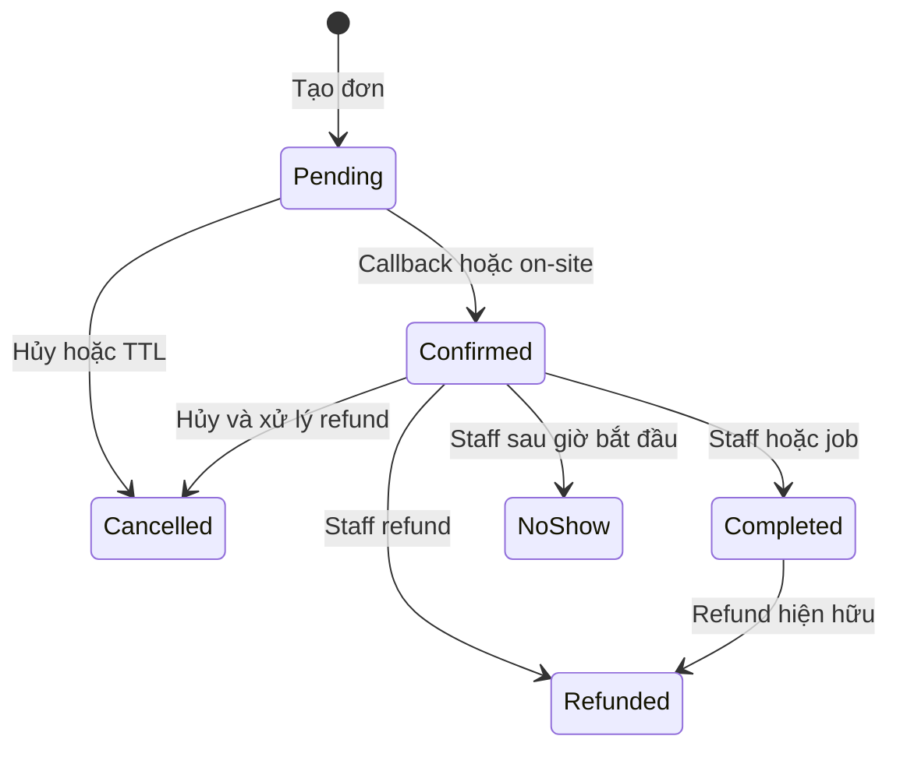

# 03 — Luồng nghiệp vụ và trạng thái đặt sân

> Chủ tài liệu: **Đinh Văn Tài**. Cập nhật: **20/10/2026**. CURRENT từ source; các chính sách mục tiêu ở [01](01-business-analysis.md).

## 1. Nguyên tắc

Ngày sân theo UTC+7, timestamp UTC, tiền nguyên VND. Browser hiển thị kết quả server; availability là snapshot, không phải khóa sân. Retry cùng ý định giữ key; key không được dùng cho actor hoặc sân/ngày/slot/nhóm/số người khác.

## 2. Đặt chỗ

| Bước | Actor/API | Kết quả |
| --- | --- | --- |
| Xem lịch | GET /bookings/availability/{branchId}/{date} | Sân/slot trống hoặc khóa |
| Chọn | Khách chọn sân/slot/ngày/số người, nhóm/voucher/điểm tùy chọn | UI tóm tắt trước xác nhận |
| Báo giá | POST /bookings/quote | Read-only; giá sân/slot không nhân người, trừ voucher/điểm; không giữ chỗ hoặc tiêu voucher/điểm |
| Tạo | POST /bookings | Check user active/verified, cửa sổ/hạn mức/nhóm/bảo trì, giá, transaction/unique |
| Giữ | Booking Pending, expiry UTC +10 phút | Giữ voucher/trừ điểm nếu có; trả mã đơn |
| Tiếp tục | Init online hoặc staff xác nhận tại quầy | Đọc lại trạng thái, không kết luận từ returnUrl |

Key có fingerprint toàn payload. Voucher/points/note thay đổi phải dùng ý định mới. Double booking bị DB từ chối, repository map lỗi unique sang domain conflict; không đè đơn khác.

## 3. Thanh toán và vòng đời

Online adapter có mock và real VnPay/MoMo/Zalopay. Mock không thu tiền thật. Adapter real có test signature/transport stub; chưa chứng minh sandbox/live. On-site Cash/QR do staff đúng cơ sở xác nhận.

Callback success/replay không cộng điểm tại Confirmed; điểm bank ở Completed. No-show có guard trước giờ bắt đầu. Quyền branch được kiểm ở service trước lifecycle/check-in. Race Complete/NoShow sử dụng conditional update; mốc auto-complete và việc staff xử lý cần nghiệm thu vận hành riêng.

## 4. Hủy và hoàn tiền

- Pending: Cancelled, trả lượt voucher và điểm đã redeem, mở slot.
- Đã trả: owner/staff hợp lệ → CancelRefundAsync → tier theo giờ Việt Nam → payment refund riêng và ledger → Cancelled/audit. Không gọi cancel rồi mất đường refund như bản cũ.
- Mốc tiền: ≥2 giờ 100%, từ 1 đến dưới 2 giờ 50%, dưới 1 giờ 0%. Hủy dưới 1 giờ không tự đồng nghĩa no-show.
- Chỉ full refund trả điểm đã dùng; clawback chỉ khi đã tồn tại earn, theo tỷ lệ tiền hoàn. Payment gốc không bị xóa.
- Timeout/crash giữa gateway và DB vẫn cần đối soát. Không coi semaphore in-process là bảo đảm end-to-end exactly-once.

## 5. Nhóm, voucher, review và membership

Nhóm owner đặt, tối đa 10 thành viên theo V1; join theo ID hiện có. Voucher preview không giữ lượt, create giữ trong transaction; unique voucher/user giới hạn một lượt. Review owner Completed một lần; Images hiện là metadata, chưa upload Storage.

Membership None/Silver/Gold đã có source/UI/admin assign, hệ số và số ngày trong MembershipSettings. Đây là mở rộng có code, không sao chép chính sách nhân sự Marixa hoặc tự suy ra đã có luồng bán subscription. Earn Completed dùng PointService/MembershipService; các test tier xác minh số điểm.

## 6. Check-in và danh sách chờ

CURRENT: chi tiết đơn trả QrToken/CheckedInAt; QR mã hóa token thực. Staff gửi token trong body POST /checkin/token, giữ route code/qr cũ và quyền theo cơ sở. Camera dùng BarcodeDetector khi trình duyệt hỗ trợ, có nhập/dán/máy quét USB dự phòng. NOT VERIFIED: camera/USB trên thiết bị thật.

Waitlist cho phép chọn trực tiếp ô “Đã đặt”, kể cả Pending; không ẩn sân khi mọi giờ đã đặt. Join khi slot đầy → Waiting → job promotion tạo Pending khi slot được giải phóng → lưu PromotedBookingId; leave kết thúc lượt. Năm worker dùng SQL application locks và heartbeat; đa instance/restart cần tải thử trước release.

CURRENT bổ sung 26/10: join và promotion kiểm giao nhau theo giờ trên cùng sân/ngày, kể cả booking dùng SlotId khác trong dữ liệu legacy: `existing.Start < requested.End && requested.Start < existing.End`, chỉ Pending/Confirmed chặn chỗ. Hai slot chỉ chạm đầu/cuối không chồng nhau. Người chờ giữ Waiting khi còn booking giao giờ; khi chỗ được nhả, tạo đơn vẫn qua guard/transaction hiện có để chống race. Không sửa dữ liệu slot hay migration lịch sử; việc DB ứng dụng có slot legacy chồng giờ vẫn NOT VERIFIED.

## 7. Jobs

| Worker | Chu kỳ source | Bất biến cần giữ |
| --- | --- | --- |
| PendingBookingExpiry | 1 phút | Slot/voucher/điểm giải phóng một lần |
| AutoComplete | 1 phút | Confirmed đủ điều kiện → Completed và earn idempotent |
| VoucherExpiry | 1 giờ | Vô hiệu đúng ngày nghiệp vụ |
| NoShowReset | 1 giờ | Mở cờ đúng kỳ |
| WaitlistPromotion | 2 phút | Không tạo hai active booking cho cùng slot |

Không bảo đảm xử lý đúng giây TTL. BackgroundJobs:Enabled=false phục vụ test/local chỉ API, không dùng để quên chạy nghiệp vụ trong production. /ready phản ánh cấu hình này.

## 8. Bảo trì và ngoại lệ UX

CURRENT: mỗi sân/ngày có một lịch Open/Maintenance/Closed, tùy chọn giờ bắt đầu/kết thúc (cùng ngày); không nhập giờ là khóa cả ngày. Khung giờ giao nhau với lịch bị khóa ngay khi khách xem ngày đó, ngoài khoảng vẫn đặt được. Mở xóa khoảng giờ khóa. Cần migration AddCourtMaintenanceHours, giữ bảng/PK/lịch sử cũ; hai cột nullable giữ lịch khóa cả ngày hiện có.

Khi khóa sân, hủy Pending và trả điểm/voucher; Confirmed hoàn toàn phần qua adapter hiện có, giữ ledger và kiểm quyền cơ sở. Nếu lỗi xử lý, giữ sân khóa và báo mã đơn để staff lưu lại cùng lịch/thử lại. Lưu lịch và tạo đơn dùng cùng transaction-owned SQL applock để tránh nhận đơn mới trong khoảng khóa. NOT VERIFIED: gateway thật/crash giữa gọi gateway và lưu ledger; không coi kiểm mock là hoàn tiền ngân hàng thật.

CURRENT bổ sung 26/10: mỗi đơn trong danh sách ảnh hưởng mang snapshot sân/ngày/slot của phạm vi bảo trì. Sau khóa chuyển trạng thái, server kiểm lại snapshot và lịch bảo trì hiện tại dưới khóa court-date trước khi hủy Pending hoặc tạo refund/online intent. Đơn đã chuyển sân/ngày/giờ ra ngoài phạm vi, hoặc lịch đã mở lại/thu hẹp không còn chặn slot, được bỏ qua; lỗi gateway/đối soát thật vẫn được báo. Không giữ transaction bao ngoài provider IO; intent online vẫn commit trước khi gọi provider.

Hủy đơn nhóm dùng chung authorization ở pending cancellation, cash/QR refund và online intent: người đặt ban đầu hoặc chủ nhóm hiện tại được hủy, ngoài quyền staff hợp lệ theo cơ sở. Server kiểm identity/active/verified và đọc owner mới dưới khóa group khi dùng quyền chủ nhóm; chuyển chủ lần nữa thu hồi quyền của chủ trung gian. Booking.UserId, tài khoản nhận hoàn, ledger điểm và voucher không chuyển theo chủ nhóm. UI hiện nút hủy cho chủ hiện tại; quyền khởi tạo thanh toán và đọc receipt vẫn giữ theo người đặt/staff.

Voucher có hiệu lực đến hết ValidUntil theo ngày Việt Nam; job khóa khi ValidUntil < hôm nay. API không cho dùng mã hết hạn ngay cả trước tick job, preview/submit báo “Voucher đã hết hạn sử dụng”.

| Ngoại lệ | Phản hồi / phục hồi |
| --- | --- |
| Slot conflict | Làm mới grid, chọn slot khác |
| Timeout tạo đơn | Xác minh kết quả bằng retry key trước tạo ý định mới |
| Callback muộn/terminal | Đối soát, không hồi sinh đơn |
| Token hết hạn | Xóa session/cache, về đăng nhập |
| Manager sai branch | Server từ chối, không render dữ liệu của cơ sở khác |
| Gateway/notify lỗi | Trạng thái chưa hoàn tất, log truy vết; không báo đã thu/đã gửi nếu chưa xác nhận |

Xem [04 API](04-system-architecture.md), [05 kiểm thử](05-testing-strategy.md), [08 backlog](08-plan.md).

## 9. Quy tắc chốt ngày 25/10/2026

Check-in từ 30 phút trước giờ bắt đầu đến hết slot, Pending phải còn TTL. Đã check-in không no-show; chỉ Completed sau check-in và hết giờ. Đơn Confirmed chưa check-in giữ để staff xác minh; dashboard có bộ lọc hiện diện. Điểm cơ bản 100.000đ=100 điểm; số dư cũ quy 1/1.000 bằng migration append-only. Chi tiết source, HTTP mới, nhóm, recovery và giới hạn snapshot tại [16](16-nonpayment-hardening.md).
