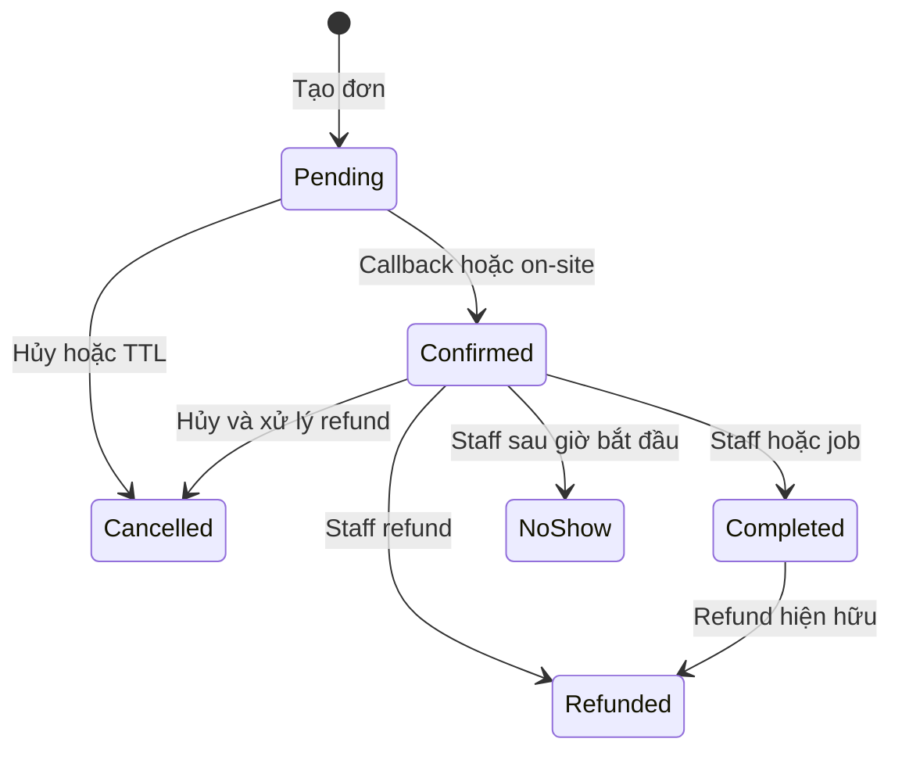

# 03 — Luồng nghiệp vụ và trạng thái đặt sân

> Chủ tài liệu: **Đinh Văn Tài**. Cập nhật: **20/10/2026**. CURRENT từ source; các chính sách mục tiêu ở [01](01-business-analysis.md).

## 1. Nguyên tắc

Ngày sân theo UTC+7, timestamp UTC, tiền nguyên VND. Browser hiển thị kết quả server; availability là snapshot, không phải khóa sân. Retry cùng ý định giữ key; key không được dùng cho actor hoặc sân/ngày/slot/nhóm/số người khác.

## 2. Đặt chỗ

| Bước | Actor/API | Kết quả |
| --- | --- | --- |
| Xem lịch | GET /bookings/availability/{branchId}/{date} | Sân/slot trống hoặc khóa |
| Chọn | Khách chọn sân/slot/ngày/số người, nhóm/voucher/điểm tùy chọn | UI tóm tắt trước xác nhận |
| Tạo | POST /bookings | Check user active/verified, cửa sổ/hạn mức/nhóm/bảo trì, giá, transaction/unique |
| Giữ | Booking Pending, expiry UTC +10 phút | Giữ voucher/trừ điểm nếu có; trả mã đơn |
| Tiếp tục | Init online hoặc staff xác nhận tại quầy | Đọc lại trạng thái, không kết luận từ returnUrl |

Key hiện chưa là hash toàn payload. Voucher/points/note thay đổi phải dùng ý định mới; phần này còn cần hardening. Double booking bị DB từ chối, repository map lỗi unique sang domain conflict; không đè đơn khác.

## 3. Thanh toán và vòng đời

Online adapter có mock và real VnPay/MoMo/Zalopay. Mock không thu tiền thật. Adapter real có test signature/transport stub; chưa chứng minh sandbox/live. On-site Cash/QR do staff đúng cơ sở xác nhận.

Callback success/replay không cộng điểm tại Confirmed; điểm bank ở Completed. No-show có guard trước giờ bắt đầu. Quyền branch được kiểm ở service trước lifecycle/check-in. Race Complete/NoShow sử dụng conditional update; mốc auto-complete và việc staff xử lý cần nghiệm thu vận hành riêng.

## 4. Hủy và hoàn tiền

- Pending: Cancelled, trả lượt voucher và điểm đã redeem, mở slot.
- Đã trả: owner/staff hợp lệ → CancelRefundAsync → tier theo giờ Việt Nam → payment refund riêng và ledger → Cancelled/audit. Không gọi cancel rồi mất đường refund như bản cũ.
- Mốc tiền: ≥2 giờ 100%, từ 1 đến dưới 2 giờ 50%, dưới 1 giờ 0%. Hủy dưới 1 giờ không tự đồng nghĩa no-show.
- Chỉ full refund trả điểm đã dùng; clawback chỉ khi đã tồn tại earn, theo tỷ lệ tiền hoàn. Payment gốc không bị xóa.
- Timeout/crash giữa gateway và DB vẫn cần đối soát. Không coi semaphore in-process là bảo đảm end-to-end exactly-once.

## 5. Nhóm, voucher, review và membership

Nhóm owner đặt, tối đa 10 thành viên theo V1; join theo ID hiện có. Voucher preview không giữ lượt, create giữ trong transaction; unique voucher/user giới hạn một lượt. Review owner Completed một lần; Images hiện là metadata, chưa upload Storage.

Membership None/Silver/Gold đã có source/UI/admin assign, hệ số và số ngày trong MembershipSettings. Đây là mở rộng có code, không sao chép chính sách nhân sự Marixa hoặc tự suy ra đã có luồng bán subscription. Earn Completed dùng PointService/MembershipService; các test tier xác minh số điểm.

## 6. Check-in và danh sách chờ

QrToken được server phát hành/lưu cho booking; staff nhập code/token qua checkin API, có branch scope. CURRENT giao diện vẫn QrTile minh họa, chưa là QR chuẩn quét được; không hứa tính năng camera scan.

Waitlist join khi slot đầy → Waiting → job promotion tạo Pending khi slot được giải phóng → lưu PromotedBookingId; leave kết thúc lượt. Năm worker dùng SQL application locks và heartbeat; đa instance/restart cần tải thử trước release.

## 7. Jobs

| Worker | Chu kỳ source | Bất biến cần giữ |
| --- | --- | --- |
| PendingBookingExpiry | 1 phút | Slot/voucher/điểm giải phóng một lần |
| AutoComplete | 1 phút | Confirmed đủ điều kiện → Completed và earn idempotent |
| VoucherExpiry | 1 giờ | Vô hiệu đúng ngày nghiệp vụ |
| NoShowReset | 1 giờ | Mở cờ đúng kỳ |
| WaitlistPromotion | 2 phút | Không tạo hai active booking cho cùng slot |

Không bảo đảm xử lý đúng giây TTL. BackgroundJobs:Enabled=false phục vụ test/local chỉ API, không dùng để quên chạy nghiệp vụ trong production. /ready phản ánh cấu hình này.

## 8. Ngoại lệ và UX

| Ngoại lệ | Phản hồi / phục hồi |
| --- | --- |
| Slot conflict | Làm mới grid, chọn slot khác |
| Timeout tạo đơn | Xác minh kết quả bằng retry key trước tạo ý định mới |
| Callback muộn/terminal | Đối soát, không hồi sinh đơn |
| Token hết hạn | Xóa session/cache, về đăng nhập |
| Manager sai branch | Server từ chối, không render dữ liệu của cơ sở khác |
| Gateway/notify lỗi | Trạng thái chưa hoàn tất, log truy vết; không báo đã thu/đã gửi nếu chưa xác nhận |

Xem [04 API](04-system-architecture.md), [05 kiểm thử](05-testing-strategy.md), [08 backlog](08-plan.md).
