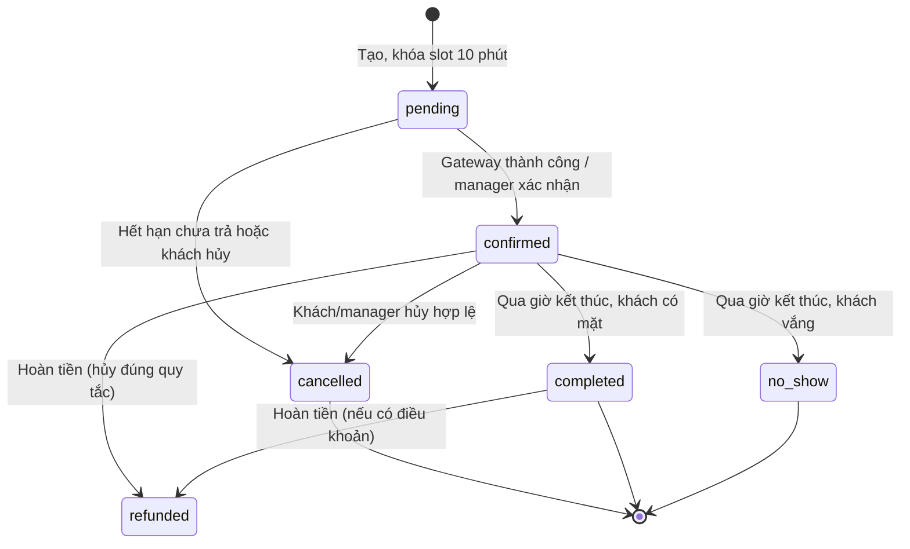

# 03 — Luồng nghiệp vụ hệ thống đặt sân cầu lông

## 1. Đặt sân và thanh toán

```mermaid
flowchart TD
  A[Khách chọn cơ sở, ngày, xem grid sân] --> B{Slot có open và trong cửa sổ đặt?}
  B -- Không --> C[Hiển thị slot khóa / hết hạn / đã bảo trì]
  B -- Có --> D[Chọn slot, số người, (voucher)]
  D --> E[Giá = peak/low + phụ thu cuối tuần - voucher]
  E --> F{Tạo nhóm?}
  F -- Có --> G[Người tạo xác nhận thành viên, chọn người chơi]
  F -- Không --> H[Tạo đặt chỗ pending]
  G --> H
  H --> I[Khóa slot 10 phút, tạo mã đặt chỗ]
  I --> J[Chọn phương thức thanh toán]
  J --> K{Trực tuyến hay tại sân}
  K -- Trực tuyến --> L[Chuyển hướng gateway VNPay/Momo/Zalopay]
  K -- Tại sân --> M[Manager xác nhận trả tiền tại quầy]
  L --> N{Gateway callback}
  M --> N
  N -- Thành công --> O[Đặt chỗ confirmed, cộng điểm, tạo QR]
  N -- Thất bại --> P[Giữ pending, khách thử lại hoặc hủy]
```

Màn hình grid chỉ cho chọn slot hợp lệ (open, trong cửa sổ, chưa bị chiếm). Giá hiển thị rõ từng khoản (giá gốc, voucher, phụ thu cuối tuần) trước khi khách xác nhận. Slot `pending` khóa đúng 10 phút; hết hạn tự mở lại. Xác nhận đặt chỗ bắt buộc qua **gateway callback hoặc manager**, không qua việc khách giữ trình duyệt.

Trước khi tạo đặt chỗ, service chạy `SELECT ... FOR UPDATE` khóa slot rồi kiểm tra unique index; nếu trùng (khách khác vừa chiếm slot), trả thông báo xung đột có hướng dẫn chọn slot khác, không ghi đè. Voucher áp dụng một lần mỗi khách, thỏa `min_spend`; nếu không hợp lệ thì không tính giảm và không cho tạo.

## 2. Quản lý đặt chỗ và hoàn tiền



Mọi chuyển trạng thái ghi `updated_at` và audit. Hủy hợp lệ chỉ giải phóng slot (index bỏ enforce); không sửa record gốc. Tỷ lệ hoàn tính theo thời điểm hủy so với giờ bắt đầu: ít nhất 2 giờ = 100%, 1–2 giờ = 50%, dưới 1 giờ = 0%; đơn chưa thanh toán không phát sinh hoàn tiền. No-show xác nhận sau giờ kết thúc, do khách tự đánh dấu hoặc manager; hoàn 0% và tích lũy cờ no-show theo quy tắc 3 lần/tháng.

## 3. Nhóm chơi

Người tạo nhóm chọn tên, giới hạn thành viên (tối đa 10), sau đó mời khách bằng mã/mã liên kết. Thành viên tham gia theo quyền của nhóm; người tạo là **người duy nhất** được tạo đặt chỗ cho nhóm và chọn người chơi. Đặt chỗ nhóm mang `group_id` khác rỗng, liệt kê người chơi trong `booking_players`; chia tiền chỉ là gợi ý (tính theo `payable / player_count`), không bắt buộc đồng tiền trong V1. Hủy đặt chỗ nhóm chỉ người tạo; thành viên chỉ xem lịch của nhóm mình.

## 4. Voucher, điểm và đánh giá

Voucher do admin tạo, có loại giảm % (có trần) hoặc giảm cố định, kèm `min_spend`, số lần dùng mỗi khách, tổng số và thời hạn. Khi khách áp voucher, hệ thống kiểm tra hạn dùng, điều kiện và việc chưa dùng trước đó; hợp lệ mới trừ vào `payable`. Điểm cộng **1 đồng = 1 điểm** khi đặt chỗ hoàn thành; hoàn tiền hợp lệ tạo giao dịch âm trong sổ điểm cùng mã đặt chỗ. Quy đổi 1.000 điểm = 20.000 đồng giảm một đơn; không quy đổi ngược thành tiền mặt.

Đánh giá chỉ tạo cho đơn đã **hoàn thành**, tối đa một đánh giá một đặt chỗ, kèm sao 1–5, bình luận và ảnh. Ảnh đánh giá lưu trong Storage, đường dẫn theo `user_id/yyyy/mm/booking_id` không chứa tên thật. Trung bình sao sân cập nhật khi có đánh giá; hủy đơn đã đánh giá giữ đánh giá nhưng gắn cờ nếu đơn bị hoàn.

## 5. Vận hành: bảo trì, no-show và đặt chỗ

Manager của cơ sở đặt bảo trì hoặc đóng sân theo khung ngày và ghi lý do; trạng thái khác `open` tự khóa slot mới, không tự hủy đặt chỗ đã `confirmed`. Khi cần hủy/hoàn đặt chỗ đã xác nhận của khách do bảo trì, manager thao tác qua API, hệ thống phát sinh hoàn tiền theo quy tắc và ghi audit. Manager đánh dấu no-show khi khách vắng sau giờ kết thúc; mỗi khách 3 lần no-show trong một tháng bị gắn cờ giới hạn đặt trong tháng kế tiếp. Admin theo dõi dashboard tỷ lệ lấp đầy peak, đơn chờ thanh toán, no-show và voucher đang chạy.

## 6. Trạng thái và lỗi cần hiển thị

| Tình huống | Phản hồi cho người dùng | Xử lý dữ liệu |
| --- | --- | --- |
| Slot trong quá khứ hoặc <30 phút | “Thời gian này không thể đặt” | Không tạo đặt chỗ |
| Slot xa hơn 30 ngày | “Vui lòng chọn ngày trong 30 ngày” | Không tạo đặt chỗ |
| Slot vừa bị khách khác đặt | “Sân này giờ này vừa được đặt, hãy chọn khung khác” | Trả xung đột, không ghi đè, grid tự làm mới |
| Voucher không hợp lệ | “Voucher không áp dụng cho đơn này” | Không trừ giảm, cho chọn voucher khác |
| Chấm/trả chậm, pending sắp hết hạn | “Đang giữ slot X phút, hãy hoàn tất thanh toán” | Job tự hủy pending sau 10 phút, mở slot |
| Gateway trả thất bại | “Thanh toán chưa thành công, hãy thử lại hoặc chọn cách khác” | Giữ pending, cho retry hoặc hủy |
| Khách đóng tab khi đang thanh toán | “Đơn của bạn đang chờ xác nhận” (khi quay lại) | Webhook là source of truth, trạng thái vẫn xác nhận nếu gateway đã trả |
| Hủy dưới 1 giờ trước giờ bắt đầu | “Không còn đủ thời gian để hoàn tiền theo quy tắc” | Trạng thái no-show/hủy, hoàn 0% |
| Sân bảo trì | “Sân đang bảo trì, chưa thể đặt” | Slot khóa, không cho đặt |
| Vượt hạn mức slot/ngày | “Bạn đã đạt giới hạn đặt trong ngày” | Không tạo đặt chỗ mới |

Chi tiết trường dữ liệu ở [02-database-design.md](02-database-design.md); kịch bản kiểm thử ở [05-testing-strategy.md](05-testing-strategy.md).
