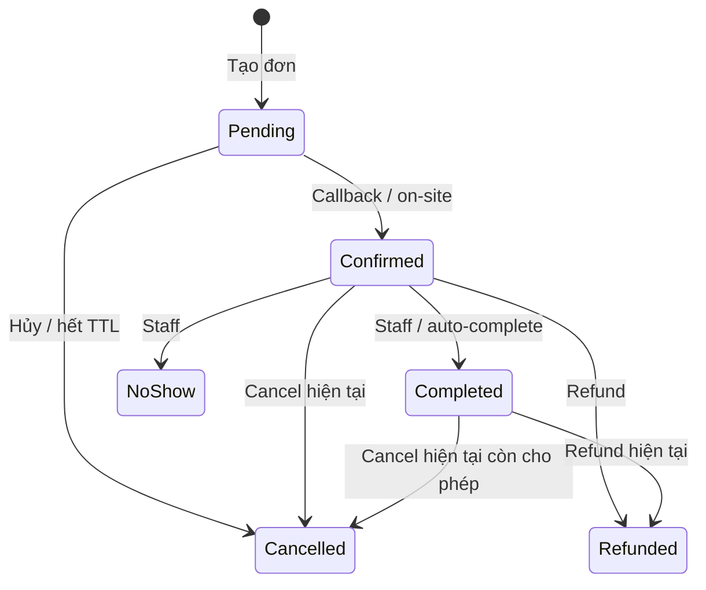

# 03 — Luồng nghiệp vụ và trạng thái đặt sân

> Chủ tài liệu: **Đinh Văn Tài**. Cập nhật: **16/10/2026**.
> CURRENT đọc từ service/controller; TARGET theo [01](01-business-analysis.md). Chưa nghiệm thu runtime trong lần sửa docs.

## 1. Quy ước chung

Ngày sân là yyyy-MM-dd theo UTC+7; timestamp là UTC. Tiền là VND nguyên; frontend hiển thị breakdown server, không tự kết luận slot đã giữ hoặc tiền đã thu. HTTP retry mutation cần idempotency ổn định cho cùng ý định; đổi payload là ý định mới.

## 2. Xem lịch và tạo đặt chỗ

| Bước | Actor / API | Dữ liệu và kết quả |
| --- | --- | --- |
| 1 | Public API GET /bookings/availability/{branchId}/{date} | Sân active, slot/lock; route SPA vẫn cần login |
| 2 | Khách chọn sân/slot | Date/slot trong cửa sổ, số người, nhóm/voucher/điểm |
| 3 | POST /bookings | CourtId, date, slotId, playerCount, groupId?, voucherCode?, pointsToRedeem?, idempotencyKey?, note? |
| 4 | BookingService | Kiểm tra user/cửa sổ/giới hạn/nhóm/bảo trì; tính giá; transaction và unique slot |
| 5 | DB | Booking Pending, PendingExpiresAt UTC +10 phút; giữ voucher/trừ điểm nếu có |
| 6 | Browser | Hiện Pending và giá; gọi init payment hoặc chờ staff xác nhận |

Xung đột trả 409 SLOT_CONFLICT; grid phải đọc lại. Availability chỉ là snapshot đọc, không phải khóa chỗ. Retry sau timeout phải đọc lại bằng idempotency, không tạo khóa mới tùy tiện. CURRENT key unique toàn hệ thống; binding actor/payload còn DATA-01.

## 3. Thanh toán

| Luồng | CURRENT | TARGET / giới hạn |
| --- | --- | --- |
| Online | POST /payments/init, MockOnlineGateway | URL mock, chưa thu tiền/chữ ký thật |
| Callback | POST /payments/webhook/{provider}, anonymous; tra gateway_ref, xử lý guard/transaction | Callback hợp lệ là nguồn xác nhận, không phải returnUrl; sandbox adapter thật còn thiếu |
| On-site | POST /payments/{bookingId}/on-site?method=cash hoặc QR, staff | Role và scope service; manager BranchId null còn rủi ro |
| Success | Pending → Confirmed; Payment Success; cộng điểm ngay | Spec yêu cầu cộng khi Completed còn DEC-01 |
| Fail/replay | Fail không xác nhận; replay thành công không cộng trùng | Muộn sau terminal phải đối soát, không hồi sinh đơn |

Client đóng tab không ngăn server xử lý callback. UI detail hiện gửi method mock, chưa dùng URL trả về để điều hướng và chưa refresh mutation đầy đủ; đây là UI-01. QR tile chỉ hình minh họa, chưa là mã check-in có xác thực.

## 4. State machine CURRENT

Sơ đồ mô tả code, không xác nhận mọi cạnh là nghiệp vụ đúng. Pending/Confirmed chiếm slot theo index; terminal không nằm trong filter. TARGET: không làm mất dấu giao dịch, không hủy đã trả mà bỏ đối soát/refund.

## 5. Hủy và hoàn tiền

**Đơn Pending:** xác thực owner/scope → Cancelled → giải phóng slot, voucher và điểm đã đổi → audit → đọc lại. CURRENT AuthorizeCancel không throw cho actor không có quyền; SEC-01 là lỗi P0.

**Đơn đã trả — TARGET:** xác thực → tính refund theo [01 §4](01-business-analysis.md#4-đặt-chỗ-hủy-và-hoàn-tiền) → yêu cầu gateway → ghi payment điều chỉnh, ledger, trạng thái/audit → đọc lại. Không kết luận hoàn từ UI hoặc xóa payment gốc.

**CURRENT:** CancelAsync chỉ đổi Cancelled/trả voucher/điểm, không gọi RefundAsync. RefundAsync chỉ staff và nhận Confirmed/Completed; hủy trước rồi refund có thể bị từ chối. Luồng này còn PAY-01, chưa nghiệm thu tự động hủy–hoàn.

Refund tạo record riêng gateway_ref REFUND-{bookingId}; replay trả record cũ. Code có claim trạng thái trước gọi gateway; cần thử crash/timeout/rollback và nhiều instance, không coi semaphore in-process là khóa phân tán.

## 6. Jobs và no-show

| Job | CURRENT | Kiểm chứng cần có |
| --- | --- | --- |
| PendingBookingExpiry | Poll 1 phút; expiry UTC; Cancelled/trả voucher/điểm | Không đúng giây thứ 600; restart/race callback không hoàn trùng |
| AutoComplete | Poll 1 phút; giờ kết thúc theo HanoiTime; Confirmed → Completed | Race staff no-show, nhiều instance và audit |
| VoucherExpiry | Poll theo giờ, vô hiệu voucher hết hạn | Boundary ngày UTC+7, retry |
| NoShowReset | Poll theo giờ, mở cờ hết kỳ | Qua tháng/năm; đủ ba lần và hết tháng giới hạn |

Lifecycle staff hiện chỉ kiểm tra Confirmed, chưa guard thời điểm hoặc scope cơ sở. NoShow cộng bộ đếm tháng và đặt cờ tháng kế. Không có chức năng khách tự gắn no-show; mốc nghiệp vụ/job cần DEC-03.

## 7. Nhóm, voucher, điểm và review

- Nhóm: POST /groups; POST /groups/{id}/join; GET /groups/mine và /{id}/members. Owner đặt nhóm; join theo ID hiện có, chưa xác nhận invite code hoặc thành viên tự xem mọi booking nhóm.
- Voucher: GET /vouchers/{code}/preview?baseAmount= cần login; danh sách chỉ staff, mutation admin. Preview chưa giữ lượt, create booking mới giữ theo transaction. Unique ép một lượt/khách.
- Điểm: ledger earn/redeem/restore/clawback theo key. 1 VND trả thành công = 1 điểm; 1.000 điểm = 20.000 VND. CURRENT earn khi Confirmed, restore mọi tỷ lệ refund; không mô tả là đã khớp spec.
- Review: GET /reviews?courtId= public; POST cần owner của Completed, một review/booking. Images là metadata string, chưa upload Storage. Đơn đã review bị điều chỉnh cần chính sách trước tự thêm cờ moderation.

## 8. Ngoại lệ và phục hồi

| Tình huống | Phản hồi cần có | Dữ liệu cần kiểm tra |
| --- | --- | --- |
| Slot bị chiếm | Chọn khung khác, làm mới grid | 0 booking active trùng |
| Timeout create | Đang xác minh, không báo thành công giả | Tra idempotency/đơn trước retry |
| Callback fail/muộn | Chờ xác nhận hoặc liên hệ đối soát | Payment vs booking terminal |
| Pending hết TTL | Chọn lại slot | Voucher/ledger một lần |
| Hủy <1h | Không đủ điều kiện hoàn tiền | Không tự suy ra no-show |
| Bảo trì | Slot khóa, hiển thị lý do | Confirmed cũ không tự hủy |
| Lỗi quyền | Không hiển thị dữ liệu, server từ chối | Owner/role/branch, không chỉ sidebar |

Nghiệm thu ở [05](05-testing-strategy.md), API ở [04](04-system-architecture.md), lỗi mở ở [08](08-plan.md).
