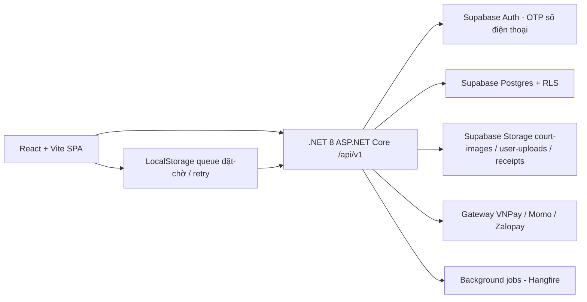

# 04 — Kiến trúc hệ thống đặt sân cầu lông

## 1. Kiến trúc tổng quan

Ứng dụng dùng TypeScript, React và Vite (SPA), triển khai frontend trên Vercel; API dùng .NET 8 ASP.NET Core chạy container Linux trên Azure App Service (hoặc Render/ECS). Supabase cung cấp Auth OTP số điện thoại, Postgres và Storage. Trang có route thật; làm mới, Back/Forward và link chi tiết giữ đúng màn hình. Giao diện khách ưu tiên mobile cho đặt sân, giao diện manager/admin ưu tiên desktop nhưng vẫn dùng được trên màn hình nhỏ. Tất cả thao tác nghiệp vụ đi qua API .NET có kiểm tra quyền; **không cho client ghi trực tiếp bảng đặt chỗ, thanh toán, điểm, voucher hoặc audit** (RLS chỉ là lớp chặn phụ, không thay thế kiểm tra nghiệp vụ ở API).

**Không dùng Docker cho frontend; API .NET đóng container Linux khi triển khai (Dockerfile một tầng runtime).** Khi phát triển, chạy Vite bằng Node.js trên máy và kết nối một Supabase project thử nghiệm riêng trên cloud; bản chính thức kết nối project production. Không chạy `supabase start` hay Supabase stack cục bộ. Migration Postgres áp trực tiếp bằng `psql`/kết nối quản trị, không phụ thuộc local stack. [Supabase yêu cầu container runtime cho local stack](https://supabase.com/docs/guides/local-development), nên local stack nằm ngoài quy trình.

Quyết định tích hợp: **Supabase Auth** cấp phát token cho khách đăng nhập bằng số điện thoại + OTP; **.NET API** xác thực JWT và áp toàn bộ nghiệp vụ đặt chỗ, giá, hoàn tiền. Supabase Postgres lưu dữ liệu; **RLS bật cho mọi bảng nghiệp vụ** theo role lưu phía database, không tin role gửi từ client. Storage bucket `court-images` công khai (ảnh sân), `user-uploads` và `receipts` riêng tư với RLS theo `auth.uid()`. `service-role` key chỉ chạy phía server .NET cho tác vụ quản trị thật sự cần, không đưa vào bundle trình duyệt. Tham khảo [Supabase Auth](https://supabase.com/docs/guides/auth) và [Supabase RLS](https://supabase.com/docs/guides/database/postgres/row-level-security).

Lưu ý nhất quán: frontend chọn **Vite SPA** (không Next.js) vì API .NET đã trả đủ REST và không cần SEO; quyết định này giữ xuyên suốt file 04, 06, 07.

## 2. Phân hệ

| Phân hệ | Trách nhiệm |
| --- | --- |
| Identity & user | OTP số điện thoại, hồ sơ khách, role customer/manager/admin, xác minh, giới hạn no-show. |
| Catalog | Cơ sở, sân, giá peak/low, phụ thu cuối tuần, khung slot, tiện ích, trạng thái bảo trì. |
| Booking | Tạo đặt chỗ idempotent, khóa slot 10 phút, nhóm chơi, hạn mức, chống overbooking. |
| Payment | VNPay/Momo/Zalopay, webhook là source of truth, hoàn tiền, đối soát, hóa đơn. |
| Voucher & points | Voucher giảm giá một lần, điểm tích lũy/đổi, quy đổi, trừ khi hoàn. |
| Review | Đánh giá sau hoàn thành, trung bình sao sân, ảnh qua Storage. |
| Admin & audit | Giá, voucher, bảo trì, nhiều cơ sở, báo cáo, nhật ký thay đổi theo quyền. |

**Giá đặt chỗ** nằm trong một service/domain duy nhất để UI, payment và dashboard không cho ra ba kết quả khác nhau: `price(court, slot, date) = (slot.peak ? court.price_peak : court.price_low_peak) * (isWeekend ? 1 + court.weekend_surcharge : 1) - voucher_discount`. Đặt chỗ, thanh toán và hoàn tiền đều đọc cùng hàm này; không tính lại ở UI.

**Chống overbooking** tập trung: service create-booking chạy transaction `SELECT ... FOR UPDATE` khóa slot rồi `INSERT`; **unique partial index** trên `(court_id, date, slot_id) WHERE status IN (pending, confirmed)` là hàng rào cuối nếu hai transaction song song. Redis distributed lock `court:{id}:{date}:{slot}` (TTL 10s) chỉ là tối ưu giảm xung đột, **không phải** source of truth.

### Phân tầng, phân module và bốn nguyên tắc OOP (áp dụng vào .NET)

Hệ thống .NET dùng Clean Architecture bốn lớp: `Domain` (entity, value object, nghiệp vụ, không phụ thuộc framework), `Application` (use-case theo CQRS-lite, không biết EF/HTTP), `Infrastructure` (EF Core, gateway thanh toán, Redis, Hangfire), `Api` (controller, mapping, validation). Mỗi module nghiệp vụ (Booking, Payment, Voucher, Review, Court) tách riêng trong `Application`, gọi qua interface định nghĩa ở `Domain`/`Application` và implement ở `Infrastructure`.

Bốn nguyên tắc OOP thể hiện thực chất trong code .NET của dự án (kèm SOLID, DRY):

1. **Encapsulation** — ẩn trạng thái, chỉ lộ behavior. `Booking` là aggregate root: `Status`, `Payable`, `BookingCode` là get-only, mutation chỉ qua `Confirm()`, `Cancel()`; value object `Money` là record struct bất biến. UI/controller không thể tự `booking.Status = ...`.
2. **Abstraction** — che phần biến, giữ phần không biến. Mọi phía ngoài domain làm việc qua interface: `IPaymentGateway`, `IBookingRepository`, `IPricingService`; implementation (VNPay, EF Core) thay được mà không sửa domain. Unit test mock interface, không cần DB.
3. **Inheritance** — dùng có chừng mực, không "thánh hóa". `AggregateRoot` (chia sẻ `Id`, `created_at`) là cha trực tiếp của các entity; không dựng cây thừa kế sâu. C# ưu tiên composition + interface (DIP) hơn inherit nhiều cấp.
4. **Polymorphism** — cùng interface, hành vi khác. Strategy cho thanh toán: `VnPayGateway`, `MomoGateway`, `ZalopayGateway` đều implement `IPaymentGateway`; service gọi một dòng `gateway.CreateAsync(...)` và runtime chọn đúng gateway. Thêm phương thức = thêm class, không sửa service (Open/Closed).

Nguyên tắc SOLID/DRY kèm theo: **Single Responsibility** (mỗi handler MediatR một việc), **Dependency Inversion** (`Domain` không tham chiếu `Infrastructure`), **Open/Closed** (mở rộng bằng thêm class), **Interface Segregation** (interface nhỏ, tránh interface phình), **Liskov** (mọi gateway thay thế được nhau). Phía React (TypeScript) áp tương ứng: state bất biến (Encapsulation), props type interface (Abstraction), composition component (Inheritance-like), render-props/HOC (Polymorphism).

## 3. Route giao diện (React SPA)

| Route | Người dùng | Nội dung |
| --- | --- | --- |
| `/login`, `/forgot-password` | Chưa đăng nhập | OTP số điện thoại, đăng nhập, tìm tài khoản. |
| `/` | Khách | Chọn cơ sở, ngày, grid sân trống (screen chính). |
| `/courts`, `/courts/:id` | Khách | Danh sách sân, chi tiết, tiện ích, đánh giá, lịch trống. |
| `/booking` | Khách | Grid đặt sân, chọn slot/số người/voucher, xác nhận, QR sau thanh toán. |
| `/booking/:id` | Chủ đặt | Chi tiết đặt chỗ, QR, hủy theo quy tắc, trạng thái thanh toán. |
| `/account`, `/account/history`, `/account/points`, `/account/vouchers` | Khách | Hồ sơ, lịch sử, điểm, voucher, nhóm. |
| `/groups`, `/groups/:id` | Khách | Nhóm chơi, thành viên, đặt cho nhóm. |
| `/admin/dashboard` | Manager, admin | KPI theo quyền: doanh thu, lấp đầy, no-show, voucher. |
| `/admin/courts`, `/admin/bookings` | Manager, admin | Quản lý sân/giá, bảo trì, xử lý đặt chỗ. |
| `/admin/vouchers`, `/admin/reports`, `/admin/audit` | Admin | Voucher, báo cáo, nhật ký; manager chỉ thấy cơ sở mình. |

Bộ lọc quan trọng (cơ sở, ngày, trạng thái, khoảng thời gian) nằm trong query string; trang chi tiết dùng URL riêng. Phân quyền route kiểm tra ở .NET API và guard phía client; ẩn menu chỉ là hỗ trợ giao diện.

## 4. Hợp đồng API V1 (đặt chỗ + thanh toán + nhóm)

API trả lỗi có mã máy đọc được (`code`), thông báo tiếng Việt (`message`) và `request_id`; lỗi validation có chi tiết trường. Mutation tạo đặt chỗ yêu cầu `idempotency_key` để retry không nhân đôi. Danh sách phân trang, lọc theo cơ sở/ngày/trạng thái, giới hạn số hàng mỗi lần gọi.

| Endpoint | Chức năng / quyền |
| --- | --- |
| `GET /api/v1/branches`, `GET /api/v1/courts?branch=&date=` | Cơ sở, sân + availability (public). |
| `GET /api/v1/courts/{id}` | Chi tiết sân, tiện ích, trung bình sao (public). |
| `POST /api/v1/bookings` | Tạo đặt chỗ pending; body có `court_id`, `date`, `slot_id`, `player_count`, `group_id?`, `voucher_code?`, `idempotency_key`; khóa slot 10 phút. (customer) |
| `GET /api/v1/bookings/{id}` | Chi tiết; chủ đặt, manager cơ sở, admin. |
| `POST /api/v1/bookings/{id}/cancel` | Hủy theo quy tắc hoàn tiền; chủ đặt hoặc manager. |
| `POST /api/v1/payments/init` | Lấy URL gateway theo `booking_id` + phương thức; idempotent theo `idempotency_key`. |
| `POST /api/v1/payments/webhook/{provider}` | Gateway callback (public, verify chữ ký); xác nhận confirmed + cộng điểm. |
| `GET /api/v1/bookings/{id}/qr` | Mã QR hợp lệ theo chủ đặt/manager. |
| `POST /api/v1/groups`, `POST /api/v1/groups/{id}/join` | Nhóm chơi; owner tạo, khách tham gia. (customer) |
| `GET /api/v1/reviews?court=` , `POST /api/v1/reviews` | Xem/tạo đánh giá (chỉ booking completed). |
| `POST /api/v1/admin/courts`, `PATCH /api/v1/admin/courts/{id}` | Giá peak/low, phụ thu, tiện ích; admin. |
| `POST /api/v1/admin/courts/{id}/maintenance` | Bảo trì/đóng sân theo ngày; manager cơ sở, admin. |
| `POST /api/v1/admin/vouchers` , `GET /api/v1/admin/reports` | Voucher và báo cáo; admin (báo cáo theo cơ sở cho manager). |

Khi hai khách cùng đặt một slot, unique partial index đảm bảo chỉ một record được giữ; record khác trả xung đột kèm mã `SLOT_CONFLICT` có hướng dẫn. Webhook payment idempotent theo `gateway_ref`; webhook lặp không đổi trạng thái. Ảnh review/đặt chỗ phải thuộc user; server kiểm tra MIME, kích thước, quyền upload. Upload ảnh không quyết định trạng thái đặt chỗ.

## 5. Thời gian và đồng bộ đặt chỗ

Client có module queue LocalStorage/IndexedDB riêng cho **đặt-chờ và retry**, không cho toàn bộ dữ liệu; đồng bộ khi mở ứng dụng và khi trình duyệt báo có mạng. Trạng thái queue: `draft_local`, `sent_pending`, `synced`, `retry_error`, `expired`. Mỗi lần retry dùng cùng `idempotency_key`; backoff có giới hạn và nút thử lại. Data local không dùng để kết luận đặt chỗ đã xác nhận.

Server lưu ba mốc khi cần: giờ tạo (UTC), giờ bắt đầu slot (xác định theo `Asia/Ho_Chi_Minh`) và giờ webhook/xác nhận. Ngày đặt và khung slot luôn theo `Asia/Ho_Chi_Minh`, không theo múi giờ của Vercel hay vùng Azure. Slot `pending` có TTL 10 phút; job kiểm soát hết hạn chạy độc lập và mở slot khi hết hạn, không phụ thuộc request.

## 6. Quan sát và hiệu năng

Ghi log có `request_id`, mã lỗi, độ trễ và ID đặt chỗ, không ghi thẻ/cá nhân hay GPS thô vào log. Theo dõi: số đặt chỗ xung đột, số pending hết hạn, webhook lỗi, dung lượng Storage/DB, độ trễ API p95. Target: API p95 < 300 ms, UI first-load (LCP) < 2 s, uptime 99.9%. Trang dashboard chỉ tải dữ liệu theo quyền, bảng phân trang; đồ thị dùng số liệu đã tổng hợp, không tải ảnh hàng loạt.

Chi tiết dữ liệu ở [02-database-design.md](02-database-design.md), giao diện ở [07-ui-design-system.md](07-ui-design-system.md), triển khai ở [06-deployment-vercel-supabase.md](06-deployment-vercel-supabase.md).
