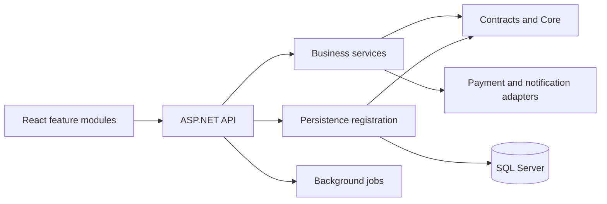

# 04 — Kiến trúc hệ thống đặt sân cầu lông

> Chủ tài liệu: **Đinh Văn Tài**. Cập nhật: **20/10/2026**. CURRENT theo checkout; bằng chứng ở [worklog](worklog.md). Không xác nhận cloud.

## 1. Kiến trúc và ranh giới

React/Vite SPA → HTTP `/api/v1` → ASP.NET Core 8 → business service → repository contract → EF Core/SQL Server hoặc PostgreSQL theo provider. Jobs chạy trong API. API adapter cung cấp JWT identity, logging, health và metrics. PostgreSQL có context/migration riêng; OTP/Storage chưa tích hợp.

## 2. Phân tầng CURRENT

| Project / folder | Trách nhiệm | Phụ thuộc cho phép |
| --- | --- | --- |
| API/Configuration | Composition, auth/CORS/rate-limit, validation, health | Services, Repositories, contracts, Core |
| API/Bootstrap | Khởi tạo DB có guard | EF/migration; không chạy khi check-config |
| API/Security | HttpCurrentUser | ASP.NET HTTP → Core ICurrentUser |
| API/Controllers | Request/response, role attribute | Contract.Services và DTO |
| Services | Nghiệp vụ, quyền dữ liệu, adapters payment/notify | Contracts, Core, ModelViews, Extensions; không tham chiếu Repositories/EF/SqlClient/HttpContext |
| Contract.Services | Interface nghiệp vụ | Contract.Repositories, Core, ModelViews |
| Repositories | EF mapping/migration/UnitOfWork, lỗi SQL và DI | Contract.Repositories, Core, EF/provider |
| Contract.Repositories | Entity và repository contract | Core; không EF |
| Core | Enum, settings, domain, lỗi trung lập, ICurrentUser | Không EF/ASP.NET |
| ModelViews | DTO HTTP | Core theo nhu cầu |
| Tests | Config/architecture, service/SQL, HTTP/JWT/Kestrel | Các project cần kiểm chứng |

Repository DI là [AddBookingPersistence](../Backend/Repositories/DependencyInjection.cs); API gọi qua [AddBookingApi](../Backend/API/Configuration/DependencyInjection.cs). Business registration ở [ServiceRegistration](../Backend/Services/DI/ServiceRegistration.cs) không tạo UnitOfWork implementation.

CURRENT 24/10: services và workers dùng IBookingCommands/IPaymentCommands/IVoucherCommands; conditional update và SQL/provider lock nằm trong Repositories. IUnitOfWork không còn nhận SQL string từ bên ngoài. Không thêm CQRS/MediatR hoặc layer rỗng chỉ để giống mẫu.

## 3. OOP và dependency inversion

BaseService/BaseApiController/BaseEntity chia sẻ hành vi thật. Interface tách persistence, payment strategy, notify channel và current user. Repository dịch unique SQL error thành UniqueConstraintException trung lập; business không bắt DbUpdateException/SqlException. ICurrentUser dùng ClaimsPrincipal .NET thuần, adapter HttpCurrentUser nằm tại API; fixture test cung cấp identity giả.

Core/contracts không được tham chiếu implementation repository; test architecture kiểm reference assembly. API là composition root, controller không new service. Tên project/path hiện hành ở [Backend/ARCHITECTURE](../Backend/ARCHITECTURE.md).

## 4. Hợp đồng HTTP

| Nhóm prefix /api/v1 | API chính / quyền |
| --- | --- |
| auth | POST register/login; chỉ Customer tự đăng ký |
| branches, courts, time-slots | GET public; mutation theo controller role, xem nghiệp vụ |
| bookings | POST, mine, detail, cancel; availability public; all/complete/no-show staff |
| payments | init, booking history; webhook provider anonymous có verification adapter; on-site/refund staff |
| groups | mine/create/join/members; owner đặt nhóm |
| vouchers, reviews | Preview cần login; review GET public, POST owner Completed |
| checkin | Staff theo cơ sở; code/QR token và danh sách slot |
| waitlist | Customer join/leave/mine |
| admin/membership | Admin assign/members |
| admin/report, admin/staff, admin/audit | Role + scope theo từng endpoint |

Response controller: `{data,message,statusCode,code}`; domain exception cùng envelope; validation 400 có VALIDATION_ERROR. 401/403/429 framework có thể không cùng body; client dùng HTTP status trước. RequestIdMiddleware cung cấp X-Request-Id; không log token/password. Không tự đổi statusCode enum/body hiện hữu để giống Marixa.

## 5. Quyền và tính nhất quán

- Owner kiểm tại service; JWT role không thay quyền sở hữu. Manager list/summary/detail/payment read/lifecycle/check-in được giới hạn branch phía server, không tin branchId query. Account không active/chưa gán cơ sở fail closed.
- Unique `(CourtId,Date,SlotId)` trên Pending/Confirmed bảo vệ giữ chỗ. Retry key được khóa theo transaction và so fingerprint SHA-256 có version, gồm actor/slot/date/group/playerCount/voucher/points/note. Đơn cũ không có fingerprint từ chối replay vì không thể chứng minh payload ban đầu.
- Tiền đơn có snapshot. Breakdown lịch sử dùng TotalAmount đã gồm phụ thu; trường WeekendSurcharge=0 vì dữ liệu cũ không lưu riêng. Không tính lại tiền theo giá sân hiện tại.
- Xác nhận thanh toán chỉ claim được Pending chưa xóa và PendingExpiresAt còn hiệu lực; repository kiểm TTL trong conditional update, kể cả thanh toán tại quầy. Cấu hình sân được validate trước khi sửa tracked entity: giá thường không âm, giá peak dương, capacity dương, phụ thu không âm và không làm giá cuối tràn int.
- Cancel đơn đã trả đi qua CancelRefundAsync. Full refund trả điểm đã dùng; earn khi Completed. Completion/expiry và ledger dùng cùng transaction; point mutation khóa theo tài khoản. Worker và thao tác thủ công dùng chung completion service. Xem [03](03-workflow.md).
- Transaction/conditional update không thay đối soát gateway khi timeout/crash. Gateway thật phải nghiệm thu sandbox trước dùng tiền thật.
- Hoàn online dùng OnlineRefundService/HttpOnlineRefundClient: intent commit trước IO, recovery chỉ query cùng request ID, chỉ ghi refund/đổi booking sau khi provider xác nhận. Pending/unknown có ở màn Đối soát; staff đúng branch xử lý khoản thu muộn/thừa. Flag mặc định tắt đến khi có merchant sandbox. Chi tiết migration/role/config ở [13](13-configuration.md).

## 6. React CURRENT

app/routes.tsx quản lý lazy routes/guards; app/Providers và queryClient quản lý cache/session; app/navigation dùng chung sidebar/mobile. modules/<feature>/pages giữ màn theo nghiệp vụ; booking tách hooks/useBookingForm và components/BookingConfirmationDrawer. services/http.ts quản lý fetch/envelope/401; services/api tách endpoint/types; utils/format và theme.css dùng chung. lib/api.ts chỉ là facade tương thích.

Token và bb_user cùng cần có khi hydrate. services/session.ts gắn token với identity của từng tab bằng bb_session_token; khi token dùng chung thay đổi, tab cũ xóa identity/cache và yêu cầu đăng nhập lại, không xóa token mới của tab khác. Transport dùng token gắn với tab, chặn mismatch trước gửi, hủy request đang chờ và từ chối response thuộc phiên cũ. 401 xóa session hiện tại; identity đổi hủy/clear query cache. Thông báo đổi mật khẩu nằm trong auth state để không mất khi Gate và trang tài khoản cùng chuyển về đăng nhập. Route guard không thay server authorization. Mobile menu mở cả vận hành; admin-only link ẩn với Manager. Không đưa logic giá/quyền server xuống component.

## 7. Startup và vận hành

[StartupConfiguration](../Backend/API/Configuration/StartupConfiguration.cs) validate trước xây host; --check-config thoát trước DB/jobs/external calls. Production không auto migrate/seed, CORS phải explicit HTTPS, payment real phải đủ cấu hình. Development có initialize flags. BackgroundJobs:Enabled tắt/bật cả năm worker; readiness bỏ heartbeat khi tắt có chủ đích và kiểm đủ năm khi bật.

/health chỉ liveness; /ready kiểm DB/heartbeat; /metrics cần được giới hạn qua mạng/ingress khi triển khai. Logging giữ request ID và file retention; không gọi log file là JSON nếu output là text. Config đầy đủ ở [13](13-configuration.md).
